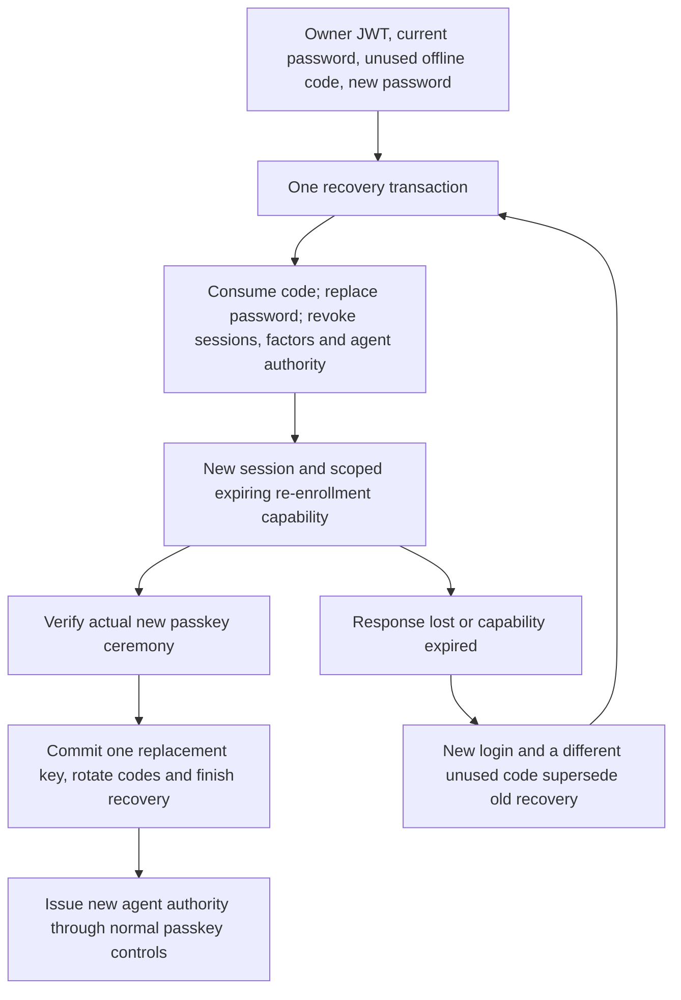

# Owner Passkey Foundation

**1. Owner authentication: passkey step-up, operation-bound challenges and secure recovery: Completed** for backend implementation and local acceptance, 14 October 2026. Enrollment, exact-operation step-up, passkey removal, recovery-code rotation and scoped lost-key recovery are implemented and browser-tested. Actual production deployment/cutover, custody and physical-device acceptance remain Goal 12 gates; they are not claimed as complete. A successful assertion or recovery capability is not a payment authorization by itself.

## Why This Exists

The existing owner JWT proves a valid password login and credential version. If that token is stolen, it can still reach owner actions. A passkey can add a separate authenticator check before a sensitive grant or approval. Rail must bind that check to the owner, current session, intended operation and exact request, not simply set a reusable `mfa=true` flag.

`@simplewebauthn/server` is pinned to 14.0.3. The implementation uses its real registration and assertion verification, including origin, RP ID, signature, presence, user verification and authenticator counter checks. See the [server verification documentation](https://simplewebauthn.dev/docs/packages/server/) and [passkey guidance](https://simplewebauthn.dev/docs/advanced/passkeys). Rail rejects cross-origin ceremonies rather than enabling framed authentication. User verification can mean an authenticator PIN or local biometric; Rail does not receive biometric data.

## Current Endpoints

Every route needs a current owner JWT, source and owner quotas, bounded JSON and `Cache-Control: no-store`. Agent/service credentials cannot act as an owner.

| Endpoint | Request | Result |
| --- | --- | --- |
| `GET /auth/passkeys` | Owner bearer token | Credential identifiers, device/backup metadata and timestamps; never keys or grants |
| `POST /auth/passkeys/register/options` | First enrollment: `{password}`; later enrollment: `{grantToken}` | Creation options, challenge ID and deadline |
| `POST /auth/passkeys/register/verify` | `{challengeId,response}` from the authenticator | Verified credential identifier |
| `POST /auth/passkeys/step-up/options` | `{operation,operationFingerprint}` | Assertion options and bound challenge |
| `POST /auth/passkeys/step-up/verify` | `{challengeId,response}` | One-time short-lived grant token and its operation binding |
| `POST /auth/passkeys/recovery-codes/rotate` | `{grantToken}` for `recovery_codes` | Ten replacement offline codes, returned once |
| `POST /auth/passkeys/revoke` | `{credentialId,grantToken}` bound to that credential | Permanent revocation, refusing removal of the last active key |
| `POST /auth/passkeys/recover` | `{password,newPassword,recoveryCode}` and current owner JWT | Session replacement and a scoped re-enrollment capability; never spending permission |

Operation names are `agent_credential`, `agent_mandate`, `agent_approval`, `passkey_enroll`, `passkey_revoke` and `recovery_codes`; all now have consumers. Removal binds `revokePasskeyFingerprint(credentialId)`, and code rotation binds the fixed exported `RECOVERY_CODES_FINGERPRINT`. Supplying a digest does not convince Rail that a payment is permitted. Financial consumers compute the normalized operation fingerprint themselves and consume the matching grant in the same transaction as the protected change.

## Sensitive Authority Changes

The HTTP runtime unconditionally enables the required owner-control boundary. These existing request bodies must include `grantToken` obtained by a same-session passkey assertion:

| Action | Operation | Server-side digest helper |
| --- | --- | --- |
| Issue `payments:execute` credential | `agent_credential` | `credentialOperationFingerprint(agentId, body)` |
| Create a spending mandate, either mode | `agent_mandate` | `mandateOperationFingerprint(agentId, body)` |
| Approve an exact intent | `agent_approval` | `approvalOperationFingerprint(agentId, intentId, requestFingerprint)` |

Helpers are exported by `agentAuthority.ts`. They hash domain-separated fixed-order JSON tuples. Scope/TTL defaults are normalized; mandate receiver lists are sorted; approval binds agent, intent and its exact request fingerprint. Grant tokens and caller-supplied verification flags are not part of authority. Changed limits, scope, lifetime, recipients, currency, mode or intent cannot reuse the grant. User, wallet, credential version and session must also match independently.

Consumption, authorization checks, credential/mandate/decision writes, protected owner evidence and events share the transaction. Failure or deferred-check failure rolls them all back. Protected receipts include original mandate/approval passkey context and the executing credential's issuance step-up. Verification checks metadata against consumed grants and immutable operation bindings. A passkey authenticates a challenge; it is not independent non-repudiation or proof that the user understood the displayed purchase.

Identical completed payment retries retain the original receipt and do not need a new owner ceremony. Approval mutation retries still require a fresh matching grant and preserve the first approval record. After a lost authority-change response, read current owner state rather than reissuing blindly. Budgets grant advance permission: an agent's later in-policy execution does not require another owner assertion for every payment.

Proposal-only credential issuance and emergency revocation do not expand spending authority. They do not require passkey grants; owner JWT authentication and current policy still apply. New privileged changes fail unavailable if no passkey service is configured. New JWTs have random IDs so separate logins in the same second do not produce identical session tokens. Ordinary human/offline payment routes retain their current contract; they are not claimed as step-up-enforced by this slice.

Isolated legacy library fixtures keep the constructor's original behavior. Direct production integrations must supply `{ required: true, store: ownerPasskeys }` exactly as the HTTP runtime does. There is no HTTP environment switch to bypass required step-up. Mixing differently configured writers is not a secure rollout.

Additional enrollment already consumes a `passkey_enroll` grant. Its fixed digest is exported as `ENROLLMENT_FINGERPRINT`; a grant for a different purpose cannot be used. First enrollment requires password reauthentication and is allowed only when no credential history exists. Two pending first-enrollment challenges cannot both register keys: after the first finishes, the other requires fresh authorization. Revoked history cannot fall back to password-only enrollment, and ordinary credential deletion is blocked.

## Binding And Transaction Rules

Owner context comes from verified JWT resolution. Only the SHA-256 fingerprint of the bearer token is stored as the session binding; raw tokens/passwords are not persisted. The store rechecks user, wallet and authentication version while locking the user row. This serializes same-owner enrollment/counter/grant changes and rejects stale sessions.

Challenges last five minutes and grants last two minutes. PostgreSQL samples one clock value for each creation/deadline pair. Claiming a challenge is atomic and one-use; a failed cryptographic verification commits that claim so the same challenge cannot be retried with another signature. A ceremony that finishes after its deadline cannot create a credential or grant. Five outstanding challenges are allowed per user across sessions/instances.

Grant tokens contain 32 random bytes and only their hash is stored. `consumeGrant` requires an existing transaction, checks owner/session/version/operation/fingerprint, current credential status and database expiry, then marks the grant consumed. If the outer protected operation rolls back, consumption rolls back too. A committed grant cannot be resurrected. Neither this method nor the authenticator approves financial policy, increases a budget or moves funds.

Credential public keys and identity/history are immutable; counters cannot decrease and revoked records cannot be restored. Zero-counter authenticators still rely on unpredictable one-use challenges; a counter is not a universal guarantee against cloning. Stored device/backup flags are checked against assertion results. There are at most ten active and one hundred retained keys per owner. Enrollment history, referenced challenges/grants and retired factors are not erased to enable a password-only bootstrap. Full archival/capacity policies remain Task 8 work.

## Recovery And Factor Lifecycle

First enrollment returns ten `rail_recovery_...` codes, each containing 32 random bytes. Only a domain-separated owner-bound hash is stored. Codes are never returned by listing or placed in URLs/events. Keep them in a secure offline/password-manager location separate from an agent's credentials. Rotating codes requires an existing-passkey assertion; it invalidates every unused prior code and returns the replacement set only after commit. Losing that response while still possessing a passkey requires another authorized rotation, not a plaintext readback.

Lost-key recovery requires current owner login, password reauthentication and an unused recovery code. The replacement password must differ and contain at least twelve characters within bcrypt's 72-byte UTF-8 bound. There is no security-question, SMS, email or operator bypass. The recovery transaction consumes the code, replaces the password, increments the session version, revokes passkeys and permanently withdraws all that wallet's agents, credentials and mandates. Pending/approved agent intents are rejected and unspent policy holds released. Already committed money, spent budget, financial receipts and other owners' agents remain unchanged. A wallet has one authentication owner; duplicate legacy mappings must be resolved before this migration.

The response contains a new JWT and a ten-minute `rail_reenroll_...` capability. Its hash binds the exact new session, credential version, owner and configured RP/origin. It can create enrollment ceremonies but cannot mint step-up grants, spend, reinstate agents or skip authenticator verification. Normal password enrollment is blocked while recovery is pending. The capability completes once, only with successful new-key registration. Two concurrent ceremonies cannot commit two replacement keys. New codes, recovery completion, the key and event commit together; a revoked old credential ID cannot be restored in place.

If a recovery response is lost, remaining codes stay usable **only until replacement enrollment succeeds**. Log in with the replacement password and recover again using another unused code and another new password. That consumes another code, revokes sessions again and supersedes the old capability. Successful re-enrollment rotates the whole remaining code set. If all factors/codes are lost, this implementation cannot establish ownership; it does not invent a support override. Recovery records retain an immutable one-to-one link to the consumed code.

Removal requires a grant for the exact credential and cannot remove the last active key. Unused grants from that credential stop working after revocation. Pending additional-enrollment ceremonies also recheck their original authorizing key; revoking it withdraws that authorization. Normal factor removal does not retroactively erase historical consent or cancel a previously delegated agent budget; use explicit agent/mandate revocation or recovery for that purpose.

One owner-user lock precedes sorted agent/control locks. SQL, audit or final-commit failure rolls back password/session changes, code consumption, factor withdrawal and allowance release. Recovery/key lifecycle events share the transactional outbox, without passwords, codes or capabilities. They are owner-visible history, **not a configured out-of-band email/push notification**. Notification delivery/custody and hosted recovery acceptance remain operational gates. Design follows the distinction between factor changes and unsafe reset bypasses in [OWASP's MFA guidance](https://cheatsheetseries.owasp.org/cheatsheets/Multifactor_Authentication_Cheat_Sheet.html).

Ceremony/lifecycle source and owner quotas are 60 and 30 requests per five minutes. The prior aggregate ten-request limit could block legitimate setup plus recovery because each ceremony uses two calls. Recovery adds a separate five-attempts-per-owner per-fifteen-minutes quota, independent of source rotation. Five outstanding challenges and ordinary financial-route quotas still apply. Retained recovery codes are capped at ten thousand rows per owner; archival/retention is a separate explicit gate, not silent deletion of security history.

## Configuration

Set both `RAIL_WEBAUTHN_RP_ID` and `RAIL_WEBAUTHN_ORIGIN`. The RP ID must equal the configured origin's hostname; there is no parent-domain/wildcard mode. The origin must be canonical, without path/query/credentials, and use HTTPS. Non-production `http://localhost:<port>` is permitted for browser development. Production localhost and partial/malformed configuration fail closed before the runtime pool opens.

If both settings are absent, ceremony routes and new privileged authority changes return unavailable; human startup remains possible with its existing required keys. No origin or passkey was configured in the real environment by this implementation. The operator must choose the actual frontend hostname and test supported authenticators before acceptance.

### Legacy Cutover

Do not upgrade old grants or receipts in place. Owner-grant links and intent step-up markers are nullable for old data and immutable. Legacy mandates cannot authorize fresh strict-runtime proposals; legacy intents cannot gain fresh execution by being reapproved; legacy execution credentials cannot spend through the strict runtime. Owner readiness hints expose these differences. Release/reject unexecuted work and issue replacement credentials/mandates/intents through real ceremonies. Emergency revocation remains available.

An owner can read old protected receipts unchanged. A fresh properly issued execution credential may retrieve an old completed result for the same agent under existing live mandate/agent checks; this is replay of historical money movement, not upgraded historical passkey consent. Retain original grant/passkey/evidence rows and keys. Drain old writers before enabling the new runtime, and do not let a compatibility library writer recreate JWT-only spending authority beside it.

## Tests And Open Gates

On 14 October 2026 the complete backend suite passed 329 tests without failures/skips. A separate Chromium journey passed against real HTTP handlers and isolated PostgreSQL storage using native WebAuthn calls and a virtual authenticator. `npm run test:browser` requires a database and installed Chromium; unavailable prerequisites fail rather than report a skipped success. CI installs Chromium and runs this journey on both supported Node versions. This is not physical-device, hosted-origin or independent security acceptance.

Recovery also revokes wallet API keys, offline tokens and unspent ordinary authorizations, returning their reservations atomically. Pending replacement enrollment blocks financial access. Money transactions recheck the authenticating user epoch/key status and hold the owner readiness lock until commit; an ingress snapshot cannot authorize new spending after recovery. Completed transfers, original receipts and other owners remain unchanged.

Tests create actual ES256 software-authenticator registration and signed assertions, passing them through the pinned verifier rather than replacing it with a success mock. PostgreSQL checks cover one-use challenges, counters, owner/session/operation substitution, UV/origin/frame denial, concurrent enrollment, quotas, expired state, immutable SQL history, migration and outer-transaction rollback. Software fixtures do not prove browser/device compatibility or hardware authenticity.

## Production Acceptance Still Required (Goal 12)

1. Physical-authenticator and hosted-origin configuration-specific acceptance. Local Chromium end-to-end acceptance has passed; Task 7 owns the larger owner dashboard.
2. Actual legacy/deployment cutover acceptance, reviewed custody/restore and consistent multi-instance configuration. Code-level cutover rejection is implemented, not a deployed migration.

Goal 1 implementation/local acceptance is complete; production deployment/custody/physical-device acceptance is not. Ordinary human transfers do not universally require passkeys, and emergency revocation intentionally remains available with current owner authentication. This preserves the project's existing human/offline scope rather than inventing a universal MFA requirement.

## Interview Explanation

A password login establishes the owner's session. A passkey adds user verification for a specific sensitive operation; it is not a reusable `mfa=true` switch. A one-use challenge/grant binds that operation to the same owner, session and exact terms. PostgreSQL consumes the grant with the change, so a failed commit cannot leave half-authorized state.

Recovery requires the current password plus an unused high-entropy recovery code. It withdraws old authority before admitting a new passkey. Codes are returned once and only hashes persist. If all required factors/codes are lost, the backend does not invent an email/support bypass. These controls protect delegated spending; they do not prove legal identity or production hardware custody.

Supported formats remain ES256/P-256, Ed25519 and RSA. Enrollment, assertion and grant use validate the key, not just its signature. Degenerate Ed25519 points are rejected using the shared validator; P-256 points must import correctly and RSA must use a 2048-4096-bit modulus and odd exponent of at least 65537. Unsafe historical keys cannot obtain/use grants. This closes a reproduced forgery without removing normal supported authenticators; production rollout still needs a retained-key audit.
