# External Payment Lifecycle Contract

## Current Status

This is the first C2 contract increment, not a deployed payment integration.
`src/domain/providerPayment.ts` supplies pure, versioned binding and transition rules.
It does not submit payments, authenticate callbacks, lease workers, persist attempts
or change wallet/shared-budget rows. Ten unit tests pass. Provider/account selection,
the real adapter, durable composition and actual sandbox acceptance remain open.

The internal wallet path remains separate and unchanged. An internal ledger entry
is not evidence that a card, bank or UPI payment settled.

## Binding A Provider Operation

Each operation binds owner, agent, intent, mandate, shared budget, provider account,
merchant, instrument reference, integer amount, currency, intent fingerprint and
authorization deadline. All references must come from trusted owner/configuration
lookups; parsing a correctly shaped string is not proof of ownership or consent.

A fixed tuple produces the operation fingerprint. Its server-generated operation ID
produces one stable provider idempotency key. Retry never generates a new key or
changes the original financial parameters. Raw card fields and unknown binding
fields are rejected. Instrument references are not a card-data collection interface.

## State And Allowance

```mermaid
stateDiagram-v2
    [*] --> reserved
    reserved --> submitting: Authority rechecked; attempt persisted
    reserved --> cancelled: Definitely not submitted
    submitting --> unknown: Response lost or uncertain
    unknown --> submitting: Same key; authority and retry window valid
    submitting --> processing: Verified observation
    submitting --> requires_owner_action: Verified observation
    unknown --> succeeded: Authoritative reconciliation
    processing --> succeeded: Authoritative reconciliation
    requires_owner_action --> succeeded: Provider confirms completion
    submitting --> succeeded: Provider confirms completion
    submitting --> failed: Confirmed terminal failure
    submitting --> cancelled: Confirmed provider cancellation
```

The diagram highlights common paths, not every normalized provider observation.

| Status | Shared allowance disposition |
| --- | --- |
| `reserved`, `submitting`, `unknown`, `processing`, `requires_owner_action` | Held |
| `succeeded` | Spent |
| `failed`, `cancelled` | Released only after the applicable definitive condition |

The disposition function is a rule, not an executed database update. Future durable
composition must apply it atomically to the actual attempt, intent, allowance,
required evidence and outbox records.

## Why Timeout Is Not Failure

Once submission may have happened, expiry, revocation or worker lease loss cannot
prove that no charge occurred. Only definitely unsubmitted work can be cancelled
locally. An unresolved liability stays held. Expired authorization blocks new
submission/retry, but never blocks reconciliation of already possible effects.

Retry windows are supplied by the selected adapter's documented guarantees. They
are not extended on retry. After the window, query/reconcile rather than resend.
For example, Stripe documents stable-key retries, indeterminate network/server
errors and reconciliation rather than starting another operation with a new key.
[Stripe advanced error handling](https://docs.stripe.com/error-low-level)

Required customer authentication is not success and not automatically final
failure. The eventual adapter must normalize its real provider states carefully;
Stripe distinguishes processing, required action and other incomplete states.
[Stripe payment status](https://docs.stripe.com/payments/payment-intents/verifying-status)
These are design references, not a declaration that Stripe has been selected.

## Adapter And Persistence Obligations

Observations are trusted internal inputs only after callback signature validation
or authenticated provider retrieval, exact account/object/amount/currency checks,
and correlation to the persisted operation. Never expose the transition function
as an agent-controlled status API. Recoverable declines must not become definitive
failure while the same provider object could still complete later.

Duplicate terminal observations and late pending observations preserve the original
terminal result. Contradictory terminal outcomes raise an explicit investigation
error rather than silently overwriting success or fabricating a refund. The durable
integration must preserve and surface that conflict for reconciliation.

Next implement immutable attempt bindings, transactional admission/leases, pre-network
authority rechecks, atomic outcome application and durable worker routing. Ordinary
event relays must never acknowledge an external payment job without executing it.
Then add verified callbacks, restart/fault tests, a real selected sandbox adapter
and sandbox evidence. None of these are complete merely because unit rules pass.
