# External Payment Lifecycle Contract

## Current Status

This is a C2 implementation in progress, not a deployed payment integration.
`src/domain/providerPayment.ts` supplies versioned binding and lifecycle rules;
`src/persistence/providerPayments.ts` persists operations and transition history,
and now composes exact owner passkey consent with mandate/shared-allowance holds.
Neither module submits payments, authenticates callbacks, leases workers or moves
internal wallet balances for external payments. Latest local acceptance passed:
436 backend tests and three Chromium journeys, zero failures/skips, dependency
audit zero known vulnerabilities. A further selected regression passed repeat
migration with admitted holds and direct counter-tampering checks (other cases
were intentionally filtered, not counted as a fresh full run). Provider/account selection, trusted target
registry integration, agent-proof admission, the durable worker, real adapter and
actual sandbox acceptance remain open.

The internal wallet path remains separate and unchanged. An internal ledger entry
is not evidence that a card, bank or UPI payment settled.

## C2 Queue Isolation Increment

The existing PostgreSQL outbox now records an immutable `work_kind`: `event` for
ordinary notifications or `provider_payment` for future payment execution work.
Existing rows and existing notification writers retain the `event` default.
Repeat migration preserves delivery state, attempts, payloads and timestamps.

The notification worker filters this category during claiming, expired-lease
cleanup, acknowledgement and failure handling. It cannot publish, acknowledge or
dead-letter payment jobs. Customer polling and SSE history also exclude payment
jobs, even if their payload contains the customer's wallet ID. A database trigger
rejects category changes; a payment job cannot be relabelled as a notification.

This is routing isolation within one existing outbox, not a second queue platform,
a new worker or a payment adapter. No runtime payment producer writes these jobs
yet. Application producers must choose the correct category when inserting work;
this is not isolation against a privileged database administrator. Future payment
workers must retain unknown financial liabilities rather than inherit notification
dead-letter/retry semantics. Verified public payment-status events will be separate
notification rows, not raw execution jobs.

New PostgreSQL regressions cover legacy/repeat migrations, invalid and changed
categories, concurrent notification relays, unchanged pending and expired payment
jobs, and wallet-visible history. On 16 October 2026, `npm test` and all three
native Chromium journeys passed on local Node 20.19.6/PostgreSQL 18.3 with no
failures or skips. Dependency audit reported zero known vulnerabilities. The
disposable database was removed. At this earlier checkpoint the increment was unpublished;
the Node 22/24 remote pass belongs to baseline `22497bd`, not these new changes.

## Binding A Provider Operation

Each operation binds owner, agent, intent, mandate, shared budget, provider account,
merchant, instrument reference, integer amount, currency, intent fingerprint and
authorization deadline. All references must come from trusted owner/configuration
lookups; parsing a correctly shaped string is not proof of ownership or consent.

A fixed tuple produces the operation fingerprint. Its server-generated operation ID
produces one stable provider idempotency key. Retry never generates a new key or
changes the original financial parameters. Raw card fields and unknown binding
fields are rejected. Instrument references are not a card-data collection interface.

## Durable Operation Journal

Each operation has one immutable binding, one provider idempotency key, a revision
and a submission-attempt count. The same operation and terms replay the stored
record; changed terms fail. A unique intent ID prevents recording a second operation
for the same proposed external intent. Foreign keys bind owner, agent, mandate
and shared budget together, without inventing internal wallet settlement entries.

Creation and transitions are server-only functions using the caller's PostgreSQL
transaction. A row lock serializes changes. Database time is sampled after the
lock, so waiting does not preserve an already-expired authorization. First-submission
time and the provider retry deadline cannot be extended. Each revision automatically
appends a history row through a database trigger; a failed journal write rolls back
the operation change. Binding/history rewrites and deletion are rejected. One
provider object cannot belong to two operations under the same provider account.

```mermaid
sequenceDiagram
    participant S as Trusted Coordinator
    participant D as PostgreSQL
    participant P as Future Provider Adapter
    S->>D: BEGIN; lock operation; check current authority
    S->>D: Record submitting + attempt + journal
    S->>D: COMMIT
    Note over S,D: No provider call while holding financial locks
    S->>P: Submit original terms and original key
    P--xS: Response lost
    S->>D: Record unknown; preserve unresolved liability
    Note over S,P: Future worker reconciles before choosing a permitted retry
```

The low-level journal still supports unadmitted component records; their
`authorizationRequired: false` marker cannot be promoted to real spending authority.
The new coordinator primitive creates `authorizationRequired: true` operations
only with fresh exact-payment consent and actual allowance holds. Database
constraints require the linked consent row at commit. Future runtime workers must
accept only admitted operations, not component/legacy records. Internal intent IDs
cannot be reused as consented external intent IDs in either creation order.

Tests use trusted synthetic bindings and observations. No callback-verification or
provider-request endpoint is added; an arbitrary caller cannot access this journal
through HTTP. Opaque account/instrument references, not credentials or raw card
data, are stored; application/database access controls remain necessary. An observed
`succeeded` state in these component tests does not establish real provider settlement.

The isolated tests cover independent connections, concurrent create/submit,
changed payloads, ownership/membership rejection, journal failure, transaction
rollback, unknown outcomes, expired windows, duplicate/conflicting observations,
provider-object uniqueness, post-lock expiry and caller-input snapshots. Independent
connections are not a worker crash/restart test; those acceptance gates remain open.

Full local acceptance used Node 20.19.6 and PostgreSQL 18.3. The generated log is
`deliverables/portfolio-maintenance/rail-c2-journal-1792175570953.log` (local only);
its disposable database was removed. The workflow includes the new journal file
in the existing provider step. This earlier checkpoint did not establish a remote
CI pass. Initial migration testing caught a PL/pgSQL `CASE` expression parse error;
parenthesizing that expression fixed it before the passing focused/full runs.

## Exact External Consent And Shared Holds

`authorizeProviderPaymentInTransaction` is a server-only coordinator primitive,
not an agent HTTP endpoint. The coordinator must first resolve provider-account,
instrument and merchant ownership from trusted configuration; string-shape checks
and the `trustedMerchantWalletId` parameter are not proof of a real merchant mapping.
That registry and the agent's proof-bound proposal/admission route remain unfinished.

Each operation requires a current owner session and a fresh passkey grant in the
separate `provider_payment` namespace. Its fixed tuple commits the complete provider
binding fingerprint and trusted merchant-wallet identity. An `agent_approval` grant
cannot authorize it. Existing mandate consent is necessary but insufficient: the
new approval explicitly authorizes external execution, and cannot bypass the
mandate's owner, agent, currency, recipient, per-payment or cumulative limits.
The first external flow deliberately requires approval for every payment, including
payments under a budgeted mandate; autonomous external policy delegation is not
silently enabled.

The same transaction consumes the one-use grant, creates an immutable consent row
and operation/journal, and reserves both the mandate and shared allowance. Internal
and external agent work compete for the same envelope. A response-loss replay
returns the admitted operation without consuming another grant or holding twice.
Any failure, including a deferred commit failure, restores the grant and counters.
Indexed deferred invariants compare aggregate counters with the actual internal
intents plus admitted external operations.

Provider write primitives reuse Rail's existing transaction-savepoint convention:
autocommit writes fail before doing work, and a caller that catches a policy error
can still commit its unrelated earlier work without consuming the failed payment's
grant. The outer caller retains responsibility for final commit and client disposal.

Before submission/retry, live owner recovery/session state, agent, mandate, shared
budget/membership, approving passkey and exact authorization deadline are rechecked
under the established owner/agent/mandate/budget/operation lock order. No network
I/O happens while these locks are held. A definitely unsubmitted operation is
cancelled on owner recovery, agent/mandate/budget/member withdrawal or expiry reads;
its allowance is released once. Submitted or unknown operations retain their holds.
Revocation or expiry prevents new submission but does not block reconciliation.
Confirmed success converts held allowance to spent; confirmed failure/cancellation
releases it. Duplicate terminal observations do not change counters again.

This is policy-allowance accounting, not proof that an external instrument is funded
or that Rail moved bank money. Tests deliberately start with zero internal-wallet
funds and assert no wallet balance or ledger changes. Provider observations remain
trusted synthetic inputs until a real adapter/callback verifier exists. The worker
must additionally persist proof admission, submission work and lease/fencing state
and produce protected external execution receipts before any runtime provider call
is enabled. No new provider jobs are enqueued yet. New external-consent tests use
generated authenticators with real WebAuthn verification; they are backend tests,
not an external-payment browser UI or physical-authenticator acceptance result.

Latest log: `deliverables/portfolio-maintenance/rail-c2-consent-1792181097993.log`,
Node 20.19.6/PostgreSQL 18.3; disposable database removal confirmed. This consent
increment includes CI coverage, but its local results are not a remote CI pass.
Check Actions for the published commit; the previously verified Node22/24 run
belongs to baseline `22497bd`.

## State And Allowance

```mermaid
stateDiagram-v2
    [*] --> reserved
    reserved --> submitting: Authority rechecked; attempt persisted
    reserved --> cancelled: Definitely not submitted
    submitting --> unknown: Response lost or uncertain
    unknown --> submitting: Same key; authority and retry window valid
    submitting --> processing: Verified observation
    submitting --> requires_owner_action: Verified observation
    unknown --> succeeded: Authoritative reconciliation
    processing --> succeeded: Authoritative reconciliation
    requires_owner_action --> succeeded: Provider confirms completion
    submitting --> succeeded: Provider confirms completion
    submitting --> failed: Confirmed terminal failure
    submitting --> cancelled: Confirmed provider cancellation
```



The diagram highlights common paths, not every normalized provider observation.

| Status | Shared allowance disposition |
| --- | --- |
| `reserved`, `submitting`, `unknown`, `processing`, `requires_owner_action` | Held |
| `succeeded` | Spent |
| `failed`, `cancelled` | Released only after the applicable definitive condition |

The disposition function is a rule, not an executed database update. Future durable
composition must apply it atomically to the actual attempt, intent, allowance,
required evidence and outbox records.

## Why Timeout Is Not Failure

Once submission may have happened, expiry, revocation or worker lease loss cannot
prove that no charge occurred. Only definitely unsubmitted work can be cancelled
locally. An unresolved liability stays held. Expired authorization blocks new
submission/retry, but never blocks reconciliation of already possible effects.

Retry windows are supplied by the selected adapter's documented guarantees. They
are not extended on retry. After the window, query/reconcile rather than resend.
For example, Stripe documents stable-key retries, indeterminate network/server
errors and reconciliation rather than starting another operation with a new key.
[Stripe advanced error handling](https://docs.stripe.com/error-low-level)

Required customer authentication is not success and not automatically final
failure. The eventual adapter must normalize its real provider states carefully;
Stripe distinguishes processing, required action and other incomplete states.
[Stripe payment status](https://docs.stripe.com/payments/payment-intents/verifying-status)
These are design references, not a declaration that Stripe has been selected.

## Adapter And Persistence Obligations

Observations are trusted internal inputs only after callback signature validation
or authenticated provider retrieval, exact account/object/amount/currency checks,
and correlation to the persisted operation. Never expose the transition function
as an agent-controlled status API. Recoverable declines must not become definitive
failure while the same provider object could still complete later.

Duplicate terminal observations and late pending observations preserve the original
terminal result. Contradictory terminal outcomes raise an explicit investigation
error rather than silently overwriting success or fabricating a refund. The durable
integration must preserve and surface that conflict for reconciliation.

Next connect the immutable journal to consented external intents, transactional
admission/leases, pre-network authority rechecks, atomic outcome accounting and
durable worker routing. Notification relays are already isolated from payment jobs.
Then add verified callbacks, actual process crash/restart tests, a selected sandbox adapter
and sandbox evidence. None of these are complete merely because unit rules pass.
