# External Payment Lifecycle Contract

## Current Status

This is a C2 implementation in progress, not a deployed payment integration.
`src/domain/providerPayment.ts` supplies versioned binding and lifecycle rules;
`src/persistence/providerPayments.ts` persists operations and transition history,
and now composes exact owner passkey consent with mandate/shared-allowance holds.
Neither module submits payments, authenticates callbacks, leases workers or moves
internal wallet balances for external payments. Latest local acceptance passed
458 backend tests and three Chromium journeys, zero failures/skips; dependency
audit reported zero known vulnerabilities. The disposable local PostgreSQL database
was removed after verification. Trusted target configuration and
proof-bound proposal admission are now implemented as described below. Stripe is
now owner-selected. Its test adapter boundary and optional callback inbox are implemented as described below;
account access, callback consumption and actual sandbox acceptance
remain open.

The 1 November owner-history increment adds the console walkthrough described in
[Owner Console](OWNER_CONSOLE.md#local-provider-walkthrough). Earlier test counts in
this guide are historical checkpoints; current acceptance is recorded in the
[project report](PROJECT_STATUS_REPORT.md#latest-status).

## Local Simulator Execution Increment

This increment adds an execution-scope proof admission route and a finite durable
worker for the local simulator only. It is not a real provider integration.

1. Create a proposal and approve its frozen terms with the owner's passkey.
2. An agent with `payments:execute` issues a fresh nonce/DPoP request to
   `POST /v2/agent/provider-payments/:operationId/execute` containing only
   `{ "requestFingerprint": "<original proposal fingerprint>" }`.
3. Rail checks agent/owner, current authority, expiry and mapping, then atomically
   claims the execution proof and creates one isolated outbox job. No second hold
   is taken. An exact request replay with a fresh proof returns the existing job.
4. The worker leases one job at a time, rechecks consent/authority and the original
   execution credential, then commits `submitting` before invoking the simulator.
5. Confirmed success consumes allowance; confirmed final failure releases it.
   Lost replies, timeouts and crashes preserve the hold until lookup resolves it.

Enable explicitly with `RAIL_PROVIDER_SIMULATOR=true`, `RAIL_DEMO_MODE=true` and a
non-production `NODE_ENV`; configure targets, authority keys, passkeys and the agent
API origin as for proposal admission. The server otherwise denies this execute
route. Run migrations first, then start the server and perform proposal/approval/
execution requests. Run `npm run provider:simulate` to process at most ten jobs.
This command runs once, not a daemon or an automatically scheduled deployment job.
Pending or lost-lease work gives a nonzero exit code for operational visibility.

Jobs contain operation/credential/proof identifiers, not raw credentials or arbitrary
instructions. Database guards freeze their binding, require genuine admitted proofs
and reject deletion/dead-lettering of linked payment jobs. Ordinary notification
workers and event readers still exclude the payment lane. Simulator effects live
in `rail_simulator_effects`, separate from the internal ledger and allowance state;
one stable idempotency key produces one stored simulated effect. No actual payment
credentials, external network request or real charge is involved.

Lease ownership and expiry fence outcome writes. After a worker has committed the
submission boundary, recovery performs lookup only: it never resubmits, even when
lookup finds no effect. A crash before the call can therefore leave an unresolved
hold that requires investigation. This is deliberately conservative, not automatic
recovery of every liveness failure. Unknown work retries lookup with bounded batches
and delay, has no attempt-limit release, and can remain pending indefinitely.
Database/adapter errors are recorded generically without leaking secret data.

Revocation ordered before the submission boundary prevents dispatch. Revocation
after that committed boundary does not guarantee cancellation of a call about to
happen; leases cannot fence an external provider's network side effect. Stable
provider idempotency and reconciliation remain essential for the future adapter.
Reconciliation remains available after credential, policy or target revocation.

Regression coverage includes actual worker subprocess kills before/after simulator
effects, restart lookup, competing leases, stale-result fencing, timeout/late reply,
decline, proof rollback, immutable job bindings and unchanged internal ledger data.
This is simulator/process evidence, not real-provider or production acceptance.
The full `npm test` run uses two concurrent files to avoid connection starvation;
explicit financial and worker concurrency tests remain concurrent. All 458 backend
tests and three existing Chromium journeys passed, with zero failures/skips and
zero known dependency vulnerabilities. Remote CI for this increment is not claimed.

## Operator Targets And Proof-Bound Proposals

The 21 October 2026 increment lets an agent propose external terms, not submit a
payment. `RAIL_PROVIDER_TARGETS` is an optional JSON array, limited to 100 entries
and 64 KiB. Every entry has exactly these fields:

```json
[{"version":1,"targetId":"demo_target","revision":1,"ownerWalletId":"owner_wallet","provider":"simulator","providerAccountRef":"account_demo","instrumentRef":"instrument_demo","merchantWalletId":"merchant_wallet","merchantRef":"merchant_demo","currency":"INR","status":"active"}]
```

Use existing owner and merchant wallet identities. Status is `active` or `revoked`.
These are operator-declared mappings, not verified provider ownership or funding.
Never store provider credentials, URLs or raw card data here. Invalid configuration
fails startup; empty configuration denies new proposals. Each instance loads an
immutable snapshot: changing or revoking a mapping requires a coordinated rollout
and draining old instances. This is not a shared live revocation control plane.

| Route | Authority and result |
| --- | --- |
| `POST /v2/agent/provider-payments` | DPoP-bound credential; creates or replays one immutable proposal |
| `GET /v2/agent/provider-payments` | DPoP-bound credential; only this agent's sanitized proposals |
| `GET /v2/agents/:agentId/provider-payments` | Owner session; exact terms for the owned agent |
| `POST /v2/agents/:agentId/provider-payments/:operationId/authorize` | Owner session plus exact-payment passkey grant; admits the stored terms |

Proposal input contains only `mandateId`, `clientRequestId`, `targetId`,
`amountMinor`, `currency` and optional `ttlSeconds` (60-900; default 300).
Owner, provider account, instrument and merchant references cannot be injected.
Server-generated operation/intent IDs, a canonical request fingerprint and the
target fingerprint freeze the terms. Reusing the client request ID with different
terms fails; identical replay returns the original snapshot. At most 1,000 proposals
are retained per agent; this bounded version has no proposal archival interface.

Proposal admission requires a genuine dispatched proof, current mandate and shared
budget, recipient/currency/amount checks and protected authority evidence. It does
not reserve money. Agent responses hide account/instrument/merchant references;
owner responses include the binding and exact `provider_payment` consent fingerprint.
Owner authorization accepts only `requestFingerprint` and `grantToken` and reserves
allowance through the existing transactional consent coordinator. The request
fingerprint returned for approval identifies the frozen operation binding.

Changed/revoked targets deny fresh authorization and beginning/retrying submission.
Historical reads, original admitted replay and reconciliation remain available so
configuration changes cannot erase outstanding financial liability. Database guards
reject proposal rewrites, proof reuse and attaching a proposal after an operation.
Routes retain existing quotas/body limits and return `Cache-Control: no-store`.

The proposal proof alone does not authorize execution. The separately enabled test-provider route above
requires a separate execution proof. There is no real-provider execute integration,
provider SDK call or settlement claim. Authenticated callbacks, real-provider recovery,
protected outcome receipts and actual sandbox acceptance remain separate work.

New regression coverage includes strict configuration/input parsing, a real loopback
HTTP journey with DPoP and WebAuthn assertions, exact owner consent, substitution,
revocation, rollback, proof reuse, owner isolation and repeat migrations. These are
local software tests, not physical authenticator or real provider acceptance.

The internal wallet path remains separate and unchanged. An internal ledger entry
is not evidence that a card, bank or UPI payment settled.

## C2 Queue Isolation Increment

The existing PostgreSQL outbox now records an immutable `work_kind`: `event` for
ordinary notifications or `provider_payment` for future payment execution work.
Existing rows and existing notification writers retain the `event` default.
Repeat migration preserves delivery state, attempts, payloads and timestamps.

The notification worker filters this category during claiming, expired-lease
cleanup, acknowledgement and failure handling. It cannot publish, acknowledge or
dead-letter payment jobs. Customer polling and SSE history also exclude payment
jobs, even if their payload contains the customer's wallet ID. A database trigger
rejects category changes; a payment job cannot be relabelled as a notification.

This original increment provided routing isolation within one existing outbox,
not a second queue platform, worker or payment adapter. At that checkpoint no runtime
payment producer wrote these jobs; the simulator increment above now creates
proof-bound linked jobs. Application producers must choose the correct category;
this is not isolation against a privileged database administrator. Future payment
workers must retain unknown financial liabilities rather than inherit notification
dead-letter/retry semantics. Verified public payment-status events will be separate
notification rows, not raw execution jobs.

New PostgreSQL regressions cover legacy/repeat migrations, invalid and changed
categories, concurrent notification relays, unchanged pending and expired payment
jobs, and wallet-visible history. On 16 October 2026, `npm test` and all three
native Chromium journeys passed on local Node 20.19.6/PostgreSQL 18.3 with no
failures or skips. Dependency audit reported zero known vulnerabilities. The
disposable database was removed. At this earlier checkpoint the increment was unpublished;
the Node 22/24 remote pass belongs to baseline `22497bd`, not these new changes.

## Binding A Provider Operation

Each operation binds owner, agent, intent, mandate, shared budget, provider account,
merchant, instrument reference, integer amount, currency, intent fingerprint and
authorization deadline. All references must come from trusted owner/configuration
lookups; parsing a correctly shaped string is not proof of ownership or consent.

A fixed tuple produces the operation fingerprint. Its server-generated operation ID
produces one stable provider idempotency key. Retry never generates a new key or
changes the original financial parameters. Raw card fields and unknown binding
fields are rejected. Instrument references are not a card-data collection interface.

## Durable Operation Journal

Each operation has one immutable binding, one provider idempotency key, a revision
and a submission-attempt count. The same operation and terms replay the stored
record; changed terms fail. A unique intent ID prevents recording a second operation
for the same proposed external intent. Foreign keys bind owner, agent, mandate
and shared budget together, without inventing internal wallet settlement entries.

Creation and transitions are server-only functions using the caller's PostgreSQL
transaction. A row lock serializes changes. Database time is sampled after the
lock, so waiting does not preserve an already-expired authorization. First-submission
time and the provider retry deadline cannot be extended. Each revision automatically
appends a history row through a database trigger; a failed journal write rolls back
the operation change. Binding/history rewrites and deletion are rejected. One
provider object cannot belong to two operations under the same provider account.

```mermaid
sequenceDiagram
    participant S as Trusted Coordinator
    participant D as PostgreSQL
    participant P as Future Provider Adapter
    S->>D: BEGIN; lock operation; check current authority
    S->>D: Record submitting + attempt + journal
    S->>D: COMMIT
    Note over S,D: No provider call while holding financial locks
    S->>P: Submit original terms and original key
    P--xS: Response lost
    S->>D: Record unknown; preserve unresolved liability
    Note over S,P: Future worker reconciles before choosing a permitted retry
```

The low-level journal still supports unadmitted component records; their
`authorizationRequired: false` marker cannot be promoted to real spending authority.
The new coordinator primitive creates `authorizationRequired: true` operations
only with fresh exact-payment consent and actual allowance holds. Database
constraints require the linked consent row at commit. Future runtime workers must
accept only admitted operations, not component/legacy records. Internal intent IDs
cannot be reused as consented external intent IDs in either creation order.

Tests use trusted synthetic bindings and observations. No callback-verification or
provider-request endpoint is added; an arbitrary caller cannot access this journal
through HTTP. Opaque account/instrument references, not credentials or raw card
data, are stored; application/database access controls remain necessary. An observed
`succeeded` state in these component tests does not establish real provider settlement.

The isolated tests cover independent connections, concurrent create/submit,
changed payloads, ownership/membership rejection, journal failure, transaction
rollback, unknown outcomes, expired windows, duplicate/conflicting observations,
provider-object uniqueness, post-lock expiry and caller-input snapshots. Independent
connections are not a worker crash/restart test; those acceptance gates remain open.

Full local acceptance used Node 20.19.6 and PostgreSQL 18.3. The generated log is
`deliverables/portfolio-maintenance/rail-c2-journal-1792175570953.log` (local only);
its disposable database was removed. The workflow includes the new journal file
in the existing provider step. This earlier checkpoint did not establish a remote
CI pass. Initial migration testing caught a PL/pgSQL `CASE` expression parse error;
parenthesizing that expression fixed it before the passing focused/full runs.

## Exact External Consent And Shared Holds

`authorizeProviderPaymentInTransaction` is a server-only coordinator primitive,
not an agent HTTP endpoint. The coordinator must first resolve provider-account,
instrument and merchant ownership from trusted configuration; string-shape checks
and the `trustedMerchantWalletId` parameter are not proof of a real merchant mapping.
That registry and the agent's proof-bound proposal/admission route remain unfinished.

Each operation requires a current owner session and a fresh passkey grant in the
separate `provider_payment` namespace. Its fixed tuple commits the complete provider
binding fingerprint and trusted merchant-wallet identity. An `agent_approval` grant
cannot authorize it. Existing mandate consent is necessary but insufficient: the
new approval explicitly authorizes external execution, and cannot bypass the
mandate's owner, agent, currency, recipient, per-payment or cumulative limits.
The first external flow deliberately requires approval for every payment, including
payments under a budgeted mandate; autonomous external policy delegation is not
silently enabled.

The same transaction consumes the one-use grant, creates an immutable consent row
and operation/journal, and reserves both the mandate and shared allowance. Internal
and external agent work compete for the same envelope. A response-loss replay
returns the admitted operation without consuming another grant or holding twice.
Any failure, including a deferred commit failure, restores the grant and counters.
Indexed deferred invariants compare aggregate counters with the actual internal
intents plus admitted external operations.

Provider write primitives reuse Rail's existing transaction-savepoint convention:
autocommit writes fail before doing work, and a caller that catches a policy error
can still commit its unrelated earlier work without consuming the failed payment's
grant. The outer caller retains responsibility for final commit and client disposal.

Before submission/retry, live owner recovery/session state, agent, mandate, shared
budget/membership, approving passkey and exact authorization deadline are rechecked
under the established owner/agent/mandate/budget/operation lock order. No network
I/O happens while these locks are held. A definitely unsubmitted operation is
cancelled on owner recovery, agent/mandate/budget/member withdrawal or expiry reads;
its allowance is released once. Submitted or unknown operations retain their holds.
Revocation or expiry prevents new submission but does not block reconciliation.
Confirmed success converts held allowance to spent; confirmed failure/cancellation
releases it. Duplicate terminal observations do not change counters again.

This is policy-allowance accounting, not proof that an external instrument is funded
or that Rail moved bank money. Tests deliberately start with zero internal-wallet
funds and assert no wallet balance or ledger changes. Provider observations remain
trusted synthetic inputs until a real adapter/callback verifier exists. The worker
must additionally persist proof admission, submission work and lease/fencing state
and produce protected external execution receipts before any runtime provider call
is enabled. No new provider jobs are enqueued yet. New external-consent tests use
generated authenticators with real WebAuthn verification; they are backend tests,
not an external-payment browser UI or physical-authenticator acceptance result.

Latest log: `deliverables/portfolio-maintenance/rail-c2-consent-1792181097993.log`,
Node 20.19.6/PostgreSQL 18.3; disposable database removal confirmed. This consent
increment includes CI coverage, but its local results are not a remote CI pass.
Check Actions for the published commit; the previously verified Node22/24 run
belongs to baseline `22497bd`.

## State And Allowance

```mermaid
stateDiagram-v2
    [*] --> reserved
    reserved --> submitting: Authority rechecked; attempt persisted
    reserved --> cancelled: Definitely not submitted
    submitting --> unknown: Response lost or uncertain
    unknown --> submitting: Same key; authority and retry window valid
    submitting --> processing: Verified observation
    submitting --> requires_owner_action: Verified observation
    unknown --> succeeded: Authoritative reconciliation
    processing --> succeeded: Authoritative reconciliation
    requires_owner_action --> succeeded: Provider confirms completion
    submitting --> succeeded: Provider confirms completion
    submitting --> failed: Confirmed terminal failure
    submitting --> cancelled: Confirmed provider cancellation
```



The diagram highlights common paths, not every normalized provider observation.

| Status | Shared allowance disposition |
| --- | --- |
| `reserved`, `submitting`, `unknown`, `processing`, `requires_owner_action` | Held |
| `succeeded` | Spent |
| `failed`, `cancelled` | Released only after the applicable definitive condition |

The disposition function is a rule, not an executed database update. Future durable
composition must apply it atomically to the actual attempt, intent, allowance,
required evidence and outbox records.

## Why Timeout Is Not Failure

Once submission may have happened, expiry, revocation or worker lease loss cannot
prove that no charge occurred. Only definitely unsubmitted work can be cancelled
locally. An unresolved liability stays held. Expired authorization blocks new
submission/retry, but never blocks reconciliation of already possible effects.

Retry windows are supplied by the selected adapter's documented guarantees. They
are not extended on retry. After the window, query/reconcile rather than resend.
For example, Stripe documents stable-key retries, indeterminate network/server
errors and reconciliation rather than starting another operation with a new key.
[Stripe advanced error handling](https://docs.stripe.com/error-low-level)

Required customer authentication is not success and not automatically final
failure. The eventual adapter must normalize its real provider states carefully;
Stripe distinguishes processing, required action and other incomplete states.
[Stripe payment status](https://docs.stripe.com/payments/payment-intents/verifying-status)
These are design references, not a declaration that Stripe has been selected.

## Adapter And Persistence Obligations

Observations are trusted internal inputs only after callback signature validation
or authenticated provider retrieval, exact account/object/amount/currency checks,
and correlation to the persisted operation. Never expose the transition function
as an agent-controlled status API. Recoverable declines must not become definitive
failure while the same provider object could still complete later.

Duplicate terminal observations and late pending observations preserve the original
terminal result. Contradictory terminal outcomes raise an explicit investigation
error rather than silently overwriting success or fabricating a refund. The durable
integration must preserve and surface that conflict for reconciliation.

The local simulator now connects consented proposals, transactional admission,
leases, pre-network authority rechecks, outcome accounting and durable worker
routing. Process-crash recovery is tested at simulator scope. Verified callbacks,
a selected real sandbox adapter and actual sandbox acceptance remain open.

## Protected Simulator Outcome Receipts

`GET /v2/agents/:agentId/provider-payments/:operationId/receipt` requires the owner
session, not an agent token. It returns `{ evidence: ... }` with status `verified`,
`not_final`, `unavailable` or `verification_unavailable`. Only `verified` includes
the decrypted receipt and envelope commitment. Responses are not cacheable and
use existing owner-control quotas. This endpoint does not create receipts.

Receipts are written by the worker atomically with final resolution/job completion,
using the existing independent authority ring and purpose-separated AES-256-GCM
plus HMAC-SHA256. They record exact consent, original challenge, operation binding,
merchant, amount/currency, journal revision, outcome and allowance disposition.
They deliberately exclude funding/account aliases. Unknown or processing outcomes
are not final receipts. Legacy outcomes without a protected receipt stay unavailable.

Every current receipt says `local_simulator_outcome`. Protection proves consistency
under Rail's server-held keys, not real settlement, a provider signature, public
nonrepudiation or blockchain publication. The receipt contract rejects nonsimulator
providers; a real adapter needs a separately reviewed evidence provenance contract.
The CLI requires `RAIL_EVIDENCE_KEY_RING`, `RAIL_RISK_RECORD_KEY_RING` and
`RAIL_AGENT_AUTHORITY_KEY_RING` with independent material before opening its pool.
Trusted in-process workers must supply `options.evidence`; without it, a batch
fails before claiming jobs or creating effects. Receipt write failures preserve holds and recover by
lookup. A missing/retired decryption key never produces a fabricated valid receipt.

## Owner-Readable Journal History

`GET /v2/agents/:agentId/provider-payments/:operationId/history?afterRevision=0&limit=25`
requires the authenticated owner of both agent and payment. It uses the existing
owner/source quotas and returns `Cache-Control: no-store`. The route rejects unknown
or duplicate query fields. `limit` is an integer from 1 to 100; `afterRevision` is
an integer from 0 to 2147483647. Invalid or foreign operation identifiers do not
permit cross-owner/agent reads.

The response contains `{ history: { operationId, status, assurance, entries,
nextAfterRevision } }`. Entries have revision, lifecycle status, event, attempt
number and recorded timestamp in ascending revision order. `nextAfterRevision` is
the last returned revision when another page exists, otherwise `null`. Reading
does not advance state, execute payments, create receipts or release holds. New
events may be appended between requests; refresh from revision zero to reload the
timeline. Current status and timeline are ordinary journal reads, not a frozen
multi-request snapshot. They exclude funding aliases, proof tokens and key material.

`assurance` is `server_journal_history`, not a protected receipt or authenticated
external settlement assertion. Use the receipt endpoint for final protected evidence.
Unapproved proposals have no admitted payment journal and therefore no history yet.

## Selected Stripe Test Adapter Boundary

The owner selected Stripe. `src/rail/stripeProvider.ts` adds an isolated test-mode
adapter using pinned `stripe@23.1.0` and API version `2026-10-28.endive`. It is
now wired to the public execute route and provider-isolated worker behind a separate
test-only flag described below. The optional callback inbox below only admits
events; it does not resolve them. Nothing is enabled by default, and adding the
dependency alone does not enable charges. There is still no real Stripe acceptance evidence.

The supported model is one configured Stripe test merchant charging a configured
customer's previously saved test card. It is not arbitrary merchant purchasing,
Connect routing, payouts, bank transfers or production support. Operators must
provision appropriately consented saved methods through Stripe's supported setup
flow; Rail does not collect, store or transmit PAN/CVC. PaymentIntents are used for
this off-session model, not as a replacement for a general hosted checkout.
[Stripe PaymentIntent creation](https://docs.stripe.com/api/payment_intents/create)

The constructor accepts a test secret key, expected account ID and at most 100
unique payment-method/customer/owner mappings. Live keys are rejected. Before a
submission it retrieves the authenticated account and verifies the saved method's
test mode, card type and attached customer. Both the frozen provider account and
merchant references must equal this account; Connect fees/destination routing are
not supported. The request uses the original operation key and frozen amount,
currency, method/customer and operation/fingerprint metadata. SDK network retries
are disabled and each request has a five-second timeout. Worker integration must
budget for multiple requests and possible late responses; it is not implemented here.

Normalization checks exact mode, account context, customer, instrument, metadata,
amount, currency, capture/confirmation settings and absence of third-party routing.
Success requires the full amount received; cancellation with any received amount
cannot release allowance. `requires_action`, `requires_payment_method` and
`requires_confirmation` remain `requires_owner_action`, never final failure.
Network/SDK errors are sanitized and treated as unresolved, not instructions to
create another payment. Stripe documents that network/server errors can leave an
operation indeterminate. [Stripe error handling](https://docs.stripe.com/error-low-level)

Recovery only reads: retrieve an already known PaymentIntent, or inspect at most
100 recent intents for the configured customer and exact operation metadata when
the response lost the ID. A missing result is unresolved, not proof of failure.
Pagination, conflicting matches or mismatched fields fail closed. This bounded
fallback can require operator investigation for high-volume customers or clock
skew beyond its five-minute allowance; it is not an exhaustive account search.
Retain original account/instrument mappings for unresolved historic operations.

`verifyWebhook` uses the SDK's exact-byte signature verification, enforces bounded
raw bodies and a five-minute past/future timestamp window, rejects live/Connect
events, and returns only an event ID, PaymentIntent ID and body hash. It does not
advance financial state or trust a snapshot status. The eventual HTTP handler must
durably deduplicate events, correlate the immutable operation and retrieve current
state before resolving anything. It currently accepts the documented snapshot
PaymentIntent event family; thin event handling is not claimed.
[Stripe webhook guidance](https://docs.stripe.com/webhooks)

Eighteen isolated boundary tests cover exact parameters, account/instrument/mode
substitution, outcome states, ambiguity, transport failure and webhook tampering.
One uses the real SDK's HTTP serialization against an in-process fake transport;
webhook tests use synthetic signatures. These are local contract tests, not Stripe
network, sandbox or deployed callback acceptance. Callback consumption and actual
sandbox acceptance remain required. The current
worker and protected Stripe outcome contract are described below.

## Durable Stripe Test Callback Inbox

`POST /v2/providers/stripe/webhook` is absent by default. Explicitly enable it with
`RAIL_STRIPE_TEST_WEBHOOKS=true`, `RAIL_DEMO_MODE=true`, a non-production
`NODE_ENV`, `RAIL_STRIPE_ACCOUNT_ID=acct_...` and the matching test endpoint's
`RAIL_STRIPE_WEBHOOK_SECRET=whsec_...`. Invalid or production configuration fails
startup before opening the database pool. No Stripe API key or charge permission
is needed by callback admission. These settings do not enable Stripe execution.

Requests must be JSON with no query parameters, include a valid exact-byte
`Stripe-Signature` and fit the configured body limit (never above 256 KiB).
Existing PostgreSQL source quotas allow 60 requests/minute; proxy trust follows
the deployment's explicit configuration. Owner/agent credentials never substitute
for the signature. Non-payment event types are authenticated and ignored.

Relevant events are durably stored in `rail_stripe_callback_inbox` before HTTP 200.
The row contains configured account, event ID, PaymentIntent ID, first body hash
and timestamps, not the raw webhook, client secret, card data or API key.
Account/event deduplication is serialized across instances. Retries with equivalent
correlation are acknowledged even if formatting changes; the original body hash is
preserved. Reusing an event ID for another PaymentIntent is a correlation conflict.
Immutable database guards prevent rewriting event identity or deleting pending work.

The default pending limit is 10000 events/account. At capacity, new events return
503 while known duplicates remain acknowledgeable. Database failures roll back
admission, so Stripe can retry. A normal notification relay cannot consume this
separate inbox. `processed_at` is reserved for transactional consumer completion;
the current endpoint never sets it. There is no automatic deletion or silent
dead-lettering of financial hints.

HTTP 200 means **received**, not processed, paid, settled or reconciled. Snapshot
amount/status fields never update money, allowance or the payment journal. A
signature proves possession of the configured endpoint secret, not the configured
account's identity by itself; the subsequent authenticated API retrieval must also
verify account/object/operation bindings. The durable consumer is still required
before enabling callback-driven recovery. Until then, this opt-in
test inbox accumulates pending events and eventually backpressures at its cap.

Tests use disposable PostgreSQL schemas, concurrent clients, a real loopback HTTP
server and synthetic SDK signatures. They cover retries, conflicts, failed inserts,
capacity races, repeat migrations, immutable fields, disabled/production settings,
forged credentials, JSON/raw-byte/body limits and unchanged financial tables.
They do not establish delivery from a registered Stripe endpoint or real sandbox
acceptance. Never enable a real event source and assume an unfinished consumer is
processing it.

## Explicit Stripe Test Execution And Protected Outcomes

`RAIL_STRIPE_TEST_PAYMENTS=true` independently enables Stripe execution admission
only in a non-production `RAIL_DEMO_MODE=true` environment. Configure a test-only
`RAIL_STRIPE_SECRET_KEY`, the expected `RAIL_STRIPE_ACCOUNT_ID`, and
`RAIL_STRIPE_INSTRUMENTS` as a JSON array of `{ ownerWalletId, paymentMethodId,
customerId }` mappings. All references must be actual preprovisioned test objects,
not example IDs. Raw card data and live keys are rejected. The server validates
configuration without making a Stripe request at startup. The finite worker, not
an agent request handler or owner page, performs provider I/O.

Stripe targets must set `provider` to `stripe`, both `providerAccountRef` and
`merchantRef` to the configured merchant account ID, and `instrumentRef` to the
mapped saved test PaymentMethod. These operator mappings do not independently
prove ownership. Stripe account/customer/method checks still occur before the API
write. Only USD and INR and amounts up to 99999999 minor units are admitted in this
bounded implementation; other currency exponents are not silently displayed as
two-decimal money. Choose an amount meeting the provider's actual currency minimum
for real acceptance. Synthetic unit fixtures do not establish provider acceptance.

The existing proposal, exact owner passkey approval and fresh execution-scope DPoP
route are reused. Execution creates one durable job for the original operation,
without another hold. A simulator-only configuration cannot admit Stripe execution.
Queued jobs are claimed by provider: a simulator worker cannot acknowledge Stripe
work, and vice versa. Existing owner/agent/budget/credential/target checks run before
the durable submission boundary. Withdrawn authority can cancel only definitely
unsubmitted work; already uncertain work is still eligible for read-only recovery.

Run `npm run provider:stripe` only against the intended isolated sandbox database
and securely provisioned test environment. It handles one finite batch, uses a
60-second lease and a 20-second provider-I/O timeout, and returns nonzero for pending
or lost-lease work. It does not deploy or schedule itself. No transaction is held
during Stripe calls. Expired leases fence database writes, not remote side effects;
late responses and crashes therefore still require reconciliation. The worker
never resubmits an unknown operation, including when read-only lookup finds no
object. Keep original configuration/keys available for unresolved operations.

For Stripe observations, a versioned provenance record binds the normalized
account/object/operation, amount, currency and status to the pinned API version.
Final journal status, provenance, allowance resolution, protected receipt and job
completion commit atomically. Receipt failure rolls them back while the independent
provider effect may already exist; a later worker must look it up rather than charge
again. Final provenance is immutable in PostgreSQL.

Simulator receipts remain version 1. Stripe API-observed test outcomes use version 2
with assurance `server_observed_stripe_test_api`; a definitely unsubmitted Stripe
cancellation uses `server_cancelled_before_submission` without invented API evidence.
These are encrypted/HMAC-protected server observations, not Stripe signatures,
nonrepudiation, blockchain evidence or live settlement certificates. The provenance
hash checks binding consistency; the trusted SDK/API boundary supplies authenticity.
It is not a substitute for authenticated retrieval or a defense against a compromised
trusted server. Historical missing evidence remains unavailable, not fabricated.

The native owner-console walkthrough also runs with a fake Stripe SDK transport,
including lost replies, shared allowance holds, lookup recovery and version-2
receipt verification. Database tests cover provider isolation, revocation before
and after submission, replay and receipt-fault rollback. Actual test-account
execution/webhook delivery and durable callback consumption still gate C2/C3.
