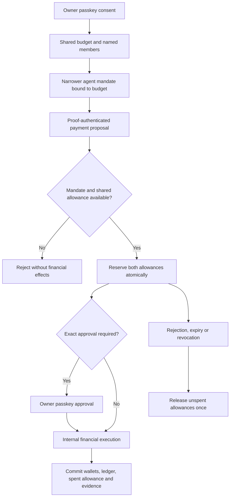

# Shared Spending Budgets

## Purpose

A wallet balance answers whether funds are available. An agent mandate answers
what one agent is allowed to request. A shared budget adds a third question:
how much may several agents collectively commit to this project?

For example, three agents request INR 6,500, INR 3,500 and INR 2,500 from a shared
INR 10,000 allowance. Each request may satisfy its own mandate, but all three
cannot reserve successfully. Admission uses the first valid database reservation,
not agent-selected priority or a guarantee about completion order.

This is a spending-policy envelope, not a bank account, funded sub-wallet or
external payment settlement. Current shared-budget execution uses Rail's existing
internal wallet engine. The external provider lifecycle is the next milestone.

## Accounting Rule

All amounts use integer minor units. INR 10,000 is `1000000` minor units.

```text
available = total limit - reserved - spent
reserved >= 0
spent >= 0
reserved + spent <= total limit
```

Pending approval and approved intents both hold allowance. Approving a request
does not reserve it again. Successful internal execution converts its hold to
spending in the same transaction as wallet/ledger changes, idempotency, authority
evidence and events. Rejection, expiry and revocation release only unspent holds.



## Owner API

These endpoints accept owner JWTs, not agent credentials. Source and owner quotas
are shared with the existing owner agent-control APIs. Responses use `no-store`.

| Method | Path | Operation |
| --- | --- | --- |
| GET | `/v2/budgets` | List the owner's budgets, members and current amounts; release expired internal intent holds transactionally |
| POST | `/v2/budgets` | Create a named, currency-bound allowance for explicit agents |
| POST | `/v2/budgets/:budgetId/limit` | Change the limit with an expected revision |
| POST | `/v2/budgets/:budgetId/member_add` | Admit another active agent owned by the same owner |
| POST | `/v2/budgets/:budgetId/member_remove` | Permanently withdraw a membership and release its unspent holds |
| POST | `/v2/budgets/:budgetId/revoke` | Permanently revoke the envelope and release its unspent holds |

Creation uses `name`, `currency`, `totalBudgetMinor`, `ttlSeconds` and `agentIds`.
Limits are positive and at most `1000000000000` minor units. Lifetime is 60 seconds
through 30 days. There are at most 50 retained budgets per owner and at most 50
agent identities per owner. Initial membership must be nonempty and unique.

Creation, limit changes and membership additions require a one-use owner passkey
grant for operation `shared_budget`. Clients calculate the exact fingerprint with
`sharedBudgetOperationFingerprint(action, budgetId, terms)` and use the existing
step-up ceremony. Limit terms include `revision`; stale revisions fail rather than
overwriting a newer decision. A new limit cannot fall below reserved plus spent.
Emergency membership withdrawal and budget revocation require the current owner
session but no new passkey ceremony. Revoked memberships cannot be resurrected.
Strict runtime spending checks creation, membership and the latest limit-control
grant. An unstepped legacy limit change cannot silently widen strict authority;
the owner must approve a new revision or replace legacy creation/membership.

An existing mandate creation request can include `sharedBudgetId`. This changes
its consent fingerprint to v2 and binds protected mandate consent to that exact
envelope. Agents do not supply or override budget IDs when proposing a payment;
the backend derives the binding from the immutable mandate. Shared-budget proposals
and intents use v4 fingerprints. Existing unbound v1-v3 requests remain unchanged.

## Database And Concurrency Decisions

`rail_shared_budgets` stores the owner, currency, limit, counters, fixed lifetime
and revision. `rail_shared_budget_members` provides composite foreign keys that
prevent linking an agent owned by someone else. `rail_shared_budget_controls`
preserves immutable canonical owner-control payloads and consumed passkey-grant
references; fingerprints are checked against payloads in PostgreSQL as well.
These control records are internal evidence, not independent blockchain attestations.

The existing authority store keeps ownership, transaction and grant consumption
boundaries. A small `sharedBudgets.ts` module centralizes input parsing, canonical
operation fingerprints and live budget/membership checks. No extra service is needed.

Owner/agent locks precede shared-budget locks. Conditional budget updates serialize
competing reservations across database clients. An intent transition trigger updates
shared counters, so existing rejection, expiry, agent revocation and owner recovery
paths cannot forget to release shared allowance. Deferred checks compare committed
counters with actual intent totals. Database guards protect immutable bindings,
control history and permanent revocation. Operators with DDL access remain trusted.

Internal execution checks live authority before payment work; the transition trigger
also denies newly committed spending against an expired/revoked budget. A late
failure rolls back money and both allowances. Deadlines are clipped to the budget's
remaining lifetime. Relevant reads release expired internal holds without depending
on a background interval. Historical completed receipts retain their shared-budget
binding, and replay does not spend again.

## Acceptance And Limits

Dedicated PostgreSQL tests cover concurrent agents, duplicate/changed proposals,
currency and owner isolation, reductions, membership removal, envelope revocation,
counter/history tampering, repeated migrations and audit/final-commit rollback.
Real-signature owner/agent tests cover exact passkey consent, HTTP controls, signed
execution, original receipt bindings and recovery. Full regression and browser
acceptance must be rerun before C1 sign-off; targeted passes alone are not sign-off.
Native Chromium uses separate original-authentication and shared-budget journeys,
each with its own database schema and credentials, rather than increasing production
ceremony limits for an oversized combined test.

This is not a fair distributed scheduler or a hosted-agent sandbox. Agents submit
data and cannot run code in Rail. Shared infrastructure can still cause contention.
Owner-approved ordinary mandates without a shared budget remain supported; this is
an explicit separate policy choice, not a promise every payment uses one envelope.

For C2, external submission/unknown outcomes must retain liabilities until provider
reconciliation. They cannot reuse internal expiry/revocation release behaviour or
the internal `executed` state without the separately approved external state machine.
