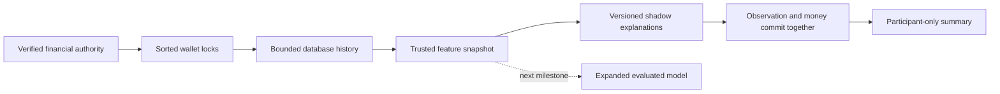
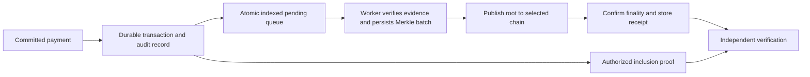
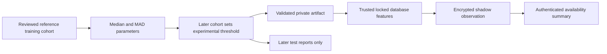

# Rail V2 Foundation

Development continues directly on `main`, starting 8 October 2026. Protected evidence and owner-controlled agent execution are implemented, followed by trusted behavioural observations. This document describes existing modules and their limits. The complete platform roadmap remains in the ignored private scope file. [SECURITY_REVIEW.md](./SECURITY_REVIEW.md) tracks the remaining defects.

## Owner Passkey Foundation

Goals 1 and 2 are Completed for backend implementation/local acceptance: 361 full backend tests and a native Chromium journey pass. Owner recovery withdraws old human/offline/agent authority. Agent authentication binds public keys, nonce/origin/raw-body proofs and opaque transactional dispatch; exact owner-approved rotation atomically replaces credentials without scope escalation or historical receipt changes. The obsolete bearer route was deleted. Shared public-key validation closes a reproduced degenerate-key forgery while retaining safe ES256/Ed25519/RSA owner support. [Owner Passkeys](OWNER_PASSKEYS.md) and [Agent Proof Of Possession](AGENT_PROOF_OF_POSSESSION.md) contain interview explanations. Physical/custody/hosted/proxy/deployed-cutover and independent acceptance remain Goal 12. Earlier preparation notes below are historical checkpoints.

`src/persistence/ownerPasskeys.ts` implements real WebAuthn ceremonies, exact-operation grants, removal/code rotation and scoped recovery; `src/server/routes/passkeyRoutes.ts` exposes owner-JWT-only, rate-limited APIs. Session hashes are resolved from unique bearer JWTs, never request JSON. Recovery codes have 256 bits of entropy and only owner-bound hashes persist. Recovery atomically changes password/session authority and withdraws factors and agent delegations through owner-first/sorted-agent locks, while preserving posted finance. A hashed scoped capability admits one new-key enrollment; completion and code rotation share its commit. Original enrollment-source grants are rechecked after revocation. SQL retains immutable referenced history and unique wallet ownership. [OWNER_PASSKEYS.md](./OWNER_PASSKEYS.md) describes response-loss, missing factors, quotas and cutover. Task 1 remains incomplete pending browser/custody/notification/actual deployment acceptance; development Playwright is being prepared, not claimed as passed.

## Agent Execution Authority Snapshots

`src/persistence/agentEvidence.ts` stores a versioned, bounded policy/intent/payment/credential snapshot using `agent-authority-v1` purpose-separated AES-256-GCM/HMAC envelopes. It reuses the existing authenticated-record primitive without changing old `risk-v1` bytes or accepting risk records as authority. The key ring is independently provisioned through `RAIL_AGENT_AUTHORITY_KEY_RING`; startup rejects overlap with configured/retained payment/risk material. Missing authority configuration disables agent spending, not ordinary human HTTP startup.

New intents require receipt version 1. `AgentAuthorityStore` completes the intent, writes required authority evidence and the execution event using the same outer financial client. Deferred checks require matching payment/fingerprint and an execution-scoped credential bound to that agent and valid at execution time. Receipt/history markers are immutable; nonce uniqueness and committed-record quotas apply. Write/quota/final-commit failure rolls back money, consumed allowance, evidence and replay. JSONB key ordering cannot change commitments because hashing uses fixed field-order encoding. Replay authenticates the original receipt without rewriting it.

Owner reads verify the envelope, commitment, key/nonce metadata and reconstructed immutable policy/payment bindings before disclosing a sanitized explanation. They use owner-only JWT authority and `no-store`. Statuses are `not_executed`, `verified`, `legacy_unavailable` and `verification_unavailable`; missing retained keys and tampering are not clean verification. Old nullable markers are preserved and historical receipts are not fabricated. Unexecuted legacy intents require new requests after releasing old holds and applying required approval.

Original owner records now use separate `agent-mandate-v1`, `agent-approval-v1` and `agent-rejection-v1` domains. `rail_agent_owner_evidence` captures immutable policy/request bindings, database time and authentication context. Owner JWT context is resolved server-side and revalidated against the current user/wallet/credential version under a shared row lock before a new record is signed. No JWT is retained and body-supplied actor fields are ignored. Stale context rejects the mutation with 401 and rollback; internal callers are labelled `trusted_library`.

New `consent_receipt_version` and `owner_evidence_version` markers require original records through deferred commit checks. Effective decisions commit evidence, state, allowance release and event together. Duplicate approvals preserve the first ciphertext; rejection adds its own record without replacing prior approval. Fresh proposals verify mandate consent before holding budget; execution verifies consent plus required approval before financial work and again when creating its receipt. The execution envelope binds original owner-record commitments, and the owner explanation includes authenticated provenance. Budgeted requests do not claim fresh human approval.

The independent authority ring's quota now covers all owner/execution encryptions. `rail_agent_evidence_nonces` records used nonces across domains; a collision aborts rather than reuses the nonce. Quotas/nonces roll back with failed writes. Old execution ciphertext remains unchanged; new nullable owner markers distinguish legacy snapshots lacking original provenance. Older mandates cannot authorize new proposals without fresh consent; readiness hints reflect the markers. Emergency revocation works without decryption keys and releases only unexecuted holds.

Assurance remains server-attested context, not independent non-repudiation or proof of physical presence. Historical JWT versions are evidence, not a requirement that the old login remain live forever; logout invalidates sessions, not all existing delegations. Authority records are not in current v1 audit roots. Stronger owner step-up, merchant-authenticated quotes, fair admission and provider execution remain next dependencies.

## Internal-Wallet Checkout Contract

### Merchant Signature Verification

`src/crypto/merchantQuotes.ts` owns the bounded recipient/key registry, canonical signing bytes, proof parsing and Ed25519 verification using [Node crypto](https://nodejs.org/docs/latest-v22.x/api/crypto.html#cryptoverifyalgorithm-data-key-signature). `merchantQuoteBytes(checkout, keyId)` serializes this UTF-8 JSON tuple:

```text
["rail:merchant-checkout:v1", keyId, version, merchantWalletId, quoteId,
 quoteVersion, subtotalMinor, feeMinor, totalMinor, currency, expiresAt,
 fundingSource.type, fundingSource.walletId]
```

The merchant signs these exact bytes with `sign(null, bytes, privateKey)` and returns canonical base64 of the 64-byte signature. Rail accepts only `{ keyId, signature }` as `merchantQuoteProof`, never a client public key or verification flag. Public keys are canonical base64 DER SPKI Ed25519 keys enrolled through operator configuration. No arbitrary JSON serialization order or client algorithm selection is used. The signing helper defines bytes but does not generate or retain private keys.

Recipients in the registry require signed checkouts on proposal, approval and fresh execution. `revoked` keys remain in the registry to prevent unsigned downgrade. v3 proposal/intent tuples append attestation version/key ID/key fingerprint/signature; v1 simple transfers and v2 unsigned checkout hashes remain unchanged. The nullable immutable `merchant_attestation` stores signature/public-key/fingerprint snapshots. SQL checks shape and a unique recipient/quote-ID index enforces single-use across versions; a shared advisory lock supplies a stable conflict response to concurrent agents. SQL does not verify cryptography or enroll trust. Protected decisions/receipts bind the snapshot, and reads verify its signature without requiring historical keys to remain active. Committed replay retains historical outcome; new spending still checks current trust.

This is operator-configured signer provenance, not merchant reputation, invoice truth, owner signature or settlement confirmation. Unregistered recipients retain unsigned compatibility. Removing all recipient entries removes mandatory proof policy and needs a reviewed cutover; direct integrations must supply the same registry as HTTP writers. No merchant onboarding/signing API, revocation service or external provider call is implemented.

`AgentCheckout` is optional on an intent. Its exact version-1 shape rejects unknown nested fields, unsupported funding types, noninteger fees and inconsistent totals. Parsing snapshots and freezes all supplied values before awaiting. JSONB storage is nullable for historical/simple transfers; `rail_agent_checkout_binding` enforces shape, receiver/currency/owner/total alignment and quote lifetime. The intent immutability trigger includes checkout.

Proposal and intent fingerprints use v2 domains with a fixed-order checkout tuple. Simple transfers retain their original v1 domains and bytes. Intent lifetime is the minimum of request TTL, mandate expiry and checkout expiry sampled from PostgreSQL time. Throwing for an expired quote rolls back any temporary budget update. Existing post-execution expiry checks protect against deadlines passing during financial work; committed replay precedes fresh-intent expiry checks. Owner decision bodies and execution snapshots append checkout only when present, preserving old encrypted evidence bindings.

Without a trusted proof the derived assurance is `agent_proposed_unverified`; signed quotes use `configured_merchant_signature`. A wallet alone is not merchant attestation. Funding is only the owner's internal wallet; subtotal plus fees is one transfer to the receiver, not provider accounting. No new network call, package or payment provider was added. Stronger owner step-up, merchant onboarding/recovery and fair admission remain separate work.

## Payment behavior

The existing flow remains: authenticate, reserve funds and persist authorization, optionally issue device-bound offline headroom, execute or sync, consume reservation and write debit/credit ledger rows. Offline features remain part of V2.

The transaction-ID-derived risk placeholder has been removed. There is currently no enforced fraud policy. Authentication, stored authorization, balance and offline-token checks still apply. ML cannot substitute for these checks or independently approve a payment.

## Trainable ML baseline

`src/risk/logisticRisk.ts` implements logistic regression using batch gradient descent on binary cross-entropy, with L2 regularization. No ML framework or external inference API is needed for this small baseline.

Two features are used: log-scaled transaction amount in minor units and an offline-channel indicator. The third weight is the intercept. Currency is declared by the dataset/model; a model is observed only for matching-currency transactions. This avoids silently treating different currencies as comparable amounts. IDs are excluded so choosing a transaction ID does not choose a risk score.

For features `x` and weights `w`, the model computes `z = sum(w[i] * x[i])`, then `p = 1 / (1 + exp(-z))`. Training adjusts weights from labeled examples rather than assigning arbitrary coefficients. Feature contributions explain the log-odds calculation; they do not establish causation.

### Dataset contract

The input JSON requires `modelVersion`, `datasetId`, `currency`, `synthetic`, and separate `training` and `validation` arrays. Each array item contains `amountMinor`, `channel`, and `label` (0 for legitimate, 1 for confirmed fraud). Training needs at least ten rows and both classes; validation needs both classes. These minimums verify the algorithm can run, not that the dataset is sufficient for fraud modeling.

Example shape, with a deliberately synthetic tiny dataset:

```json
{
  "modelVersion": "experiment-001",
  "datasetId": "synthetic-demo",
  "currency": "INR",
  "synthetic": true,
  "training": [
    {"amountMinor": 100, "channel": "online", "label": 0},
    {"amountMinor": 200, "channel": "online", "label": 0},
    {"amountMinor": 300, "channel": "online", "label": 0},
    {"amountMinor": 400, "channel": "online", "label": 0},
    {"amountMinor": 500, "channel": "online", "label": 0},
    {"amountMinor": 1000000, "channel": "nfc", "label": 1},
    {"amountMinor": 1100000, "channel": "ble", "label": 1},
    {"amountMinor": 1200000, "channel": "qr", "label": 1},
    {"amountMinor": 1300000, "channel": "nfc", "label": 1},
    {"amountMinor": 1400000, "channel": "qr", "label": 1}
  ],
  "validation": [
    {"amountMinor": 150, "channel": "online", "label": 0},
    {"amountMinor": 1250000, "channel": "ble", "label": 1}
  ]
}
```

Train using an existing dataset path and a new output path:

```bash
npm run risk:train -- /private/path/dataset.json /private/path/model.json
```

The command writes a model artifact with provenance and weights, refuses to overwrite an existing output file, and prints validation metrics. Real datasets must be protected outside the repository. Do not label operational events as confirmed fraud without a reliable outcome source.

### Evaluation and deployment

Log loss measures confidence in the correct label. Brier score measures squared probability error. Precision and recall are reported at threshold 0.5; this is an experiment threshold rather than a payment policy. Temporal split, customer leakage prevention, class imbalance, calibration, threshold costs and drift monitoring still require dedicated validation. The command accepts supplied splits; it cannot establish their independence or verify the truth of the labels.

`RAIL_RISK_MODEL_PATH` points to the legacy validated model JSON loaded once at server-context creation. An invalid configured model stops initialization. Expanded logistic and anomaly artifacts have their own optional variables described below; without any configured artifact, there is no trained inference. No default trained model is shipped because this repository contains no validated real fraud dataset.

Legacy unprotected library callers using the amount/channel model append `risk.shadow_assessed` with probability and contributions. Protected HTTP runtimes suppress that event to avoid retaining an unencrypted inference copy; inference is captured after financial locking inside the protected risk record instead. Safe `risk.behaviour` lifecycle events still share the financial transaction. The existing worker delivers at least once; consumers must deduplicate delivery IDs. External acknowledgement and production delivery acceptance remain separate from event persistence.

The tests use synthetic examples to verify learning, evaluation, validation and independence from transaction IDs. Their results say nothing about fraud detection accuracy on real transactions.

## Trusted Behavioural Observations

`src/risk/behaviourRisk.ts` collects point-in-time feature snapshots through the supplied financial client after authorization/offline-token checks and sorted wallet locks. History uses posted sender debits joined to persisted executions and used authorizations, restricted to wallet/currency and a 30-day database-clock window. The current transaction is excluded. The query returns at most 1,001 rows; only 1,000 are used and the extra row marks truncation. An indexed sender/currency/time path supports the query, but production latency/load testing remains required.

Features include sampled five-minute payment count, sample-local recipient familiarity, historical mean amount, current-to-mean ratio, statistical amount deviation and optional mandate exposure. Welford's running mean/variance avoids false deviations from constant amounts. Fewer than five samples or zero variance yields no z-score. Features are observations, not fraud probabilities. The fixed thresholds are demonstration policy choices: five recent payments, three-times mean amount, a z-score of three or exposure of 80 percent produce explanation codes without blocking money.

History describes rows visible at the collection statement, including earlier work in a caller-owned transaction. `committed_at` is a stored database transaction timestamp, not proof of the exact instant an outer commit completed. Concurrent normal transfers from the same wallet serialize under wallet locks, so subsequently collected snapshots include their visible predecessors. Offline histories measure reconnect/server processing, not claimed disconnected-device event times. Client timestamps, confidence, history and device-change claims do not enter the trusted feature calculation. Device changes explicitly remain `not_assessed` until enrollment/revocation history is implemented.

`rail_risk_observations` binds one immutable observation to the execution fingerprint. It retains database observation time, explanation and model status; protected records retain detailed features, model hash and predictions only in the separate envelope, while legacy plaintext records retain those fields relationally. The pipeline validates/copies its models at construction so caller mutation cannot change the captured version or weights. Expanded inference is available through the optional behavioural artifact below; the legacy model retains its amount/channel features. Missing configuration, currency mismatch or an expanded model not yet valid for the observation time stores an explicit status and no fabricated probability.

New standard-pipeline execution rows set `risk_required`; deferred commit checks reject missing observations. Observation failure rolls back the financial attempt, and retry is allowed. Successful replay does not overwrite observations or re-run a new model. Legacy records are not silently backfilled. Protected HTTP records additionally require the separate encrypted risk envelope described below. These safeguards do not prevent a privileged database owner from disabling triggers. Retention, label provenance, key recovery and access auditing require further work before production.

`GET /v1/payments/:txId/risk` returns only a participant-authorized summary: `observed`, `legacy_unobserved` or `verification_unavailable`. Observed responses identify `verified` protection or `legacy_plaintext`; unavailable verification omits time/assessment/model details. Raw historical feature values, probabilities and model hashes are not exposed. Missing and unauthorized payments share 404, responses are non-cacheable and reads have a 30/minute wallet/source quota. `review` does not create a pending money state; `normal` does not certify safety.



Automated fraud enforcement is not enabled by collecting these observations. Real outcome/feature provenance review, drift monitoring and production evaluation remain necessary.

## Expanded Behavioural ML

`src/risk/behaviourModel.ts` implements an optional logistic model with ten fixed, versioned features: intercept, log amount, offline-channel indicator, sampled velocity, amount ratio, positive statistical deviation, receiver unseen in the sample, agent budget exposure, incomplete history and unavailable budget. Values are bounded/normalized; missing history and budget are explicit indicators rather than fabricated observations. Device claims and payment IDs are not model inputs. Feature contributions explain additive log odds, not causation or payment authority.

Both logistic schemas share one bounded batch-gradient implementation in `logisticRisk.ts`, with the same L2 regularization and deterministic training. Expanded artifacts declare `featureSchema: "behaviour-v1"`, currency, model/dataset versions, a SHA-256 hash of the serialized supplied dataset, synthetic status, training-row count, last training-label availability time and exactly ten finite weights. Validators reject malformed provenance, sparse/non-finite vectors and unsupported schemas. The hash records supplied data; it does not prove authentic labels, independence or permission to use customer data.

### Expanded Dataset Contract

Use `npm run risk:train -- /private/path/behaviour-dataset.json /private/path/behaviour-model.json`. The command selects expanded training when the input declares `featureSchema: "behaviour-v1"`; old amount/channel datasets still work without that field. Input is capped at 20 MiB, each expanded split at 10,000 rows and runtime artifacts at 1 MiB. Outputs are created with mode 0600 and cannot overwrite existing artifacts. No default expanded model or real fraud dataset is shipped.

Dataset metadata: `featureSchema`, `modelVersion`, `datasetId`, `currency`, `synthetic`. Arrays: `training` (at least ten rows), `validation` and `test` (at least two each); every split must contain both labels. Each row contains:

| Field | Meaning |
| --- | --- |
| `eventId` | Unique event reference across all splits; no payment identifier is used as a feature. |
| `amountMinor`, `channel` | The observed payment values, in the dataset's declared currency. |
| `features` | A complete version-1 persisted feature snapshot, including database observation time and source. |
| `label` | 0 or 1 from an independently reviewed outcome, not an automatic risk score. |
| `labelObservedAt` | UTC timestamp when that outcome became available; must not precede observation. |
| `labelSource` | `synthetic` for synthetic datasets, otherwise `confirmed_outcome`; declaration still needs independent verification. |

All timestamps use canonical UTC ISO strings with milliseconds. Rows are observation-time ordered within each split. The latest training label must become available strictly before the first validation observation; the latest validation label must become available strictly before the first test observation. This prevents fitting with future labels and overlapping periods. Only training rows fit weights. Validation/test labels produce reports and affect provenance hash, not fitted weights. The caller must still exclude future-derived features, review entity leakage and establish honest labels: timestamps/source declarations alone cannot prove those facts.

### Evaluation and Runtime

The report returns validation and untouched-test log loss, Brier score, precision/recall and false-positive rate at experimental threshold 0.5, confusion counts, tied-score-safe average precision, ten calibration bins and expected calibration error. A separate warmed local-inference benchmark reports median/p95/max time over 1,000 calls; it excludes SQL, networking, evidence and financial commit and is not an end-to-end latency promise. Timings are machine-dependent and do not enter deterministic model weights or evaluation. These are diagnostics, not a fitted calibration transform or a release approval. Synthetic reports explicitly warn that they do not validate real fraud detection. Production thresholds require real class imbalance/cost analysis, meaningful sample sizes and temporal/entity leakage review; no accuracy percentage is claimed.

Configure the resulting artifact as `RAIL_BEHAVIOUR_MODEL_PATH`. The pipeline copies/validates it once and runs inference only after collecting trusted features under financial locks. A configured expanded model takes precedence over the legacy model; currency mismatch or a training cutoff at/after observation time does not silently switch to legacy inference. It records `currency_mismatch` or `not_yet_valid` with no probability, while deterministic shadow explanations and financial checks remain active. `risk.behaviour` lifecycle events are committed with the payment. Existing successful replay retains its original prediction/version/hash even after a model rollback or replacement.

Expanded inference remains shadow-only. It neither approves an intent nor denies funds, changes offline allowances or bypasses authentication/authorizations. Switch artifacts only through a reviewed configuration restart/cutover; no automatic retraining or model-driven enforcement is implemented. Offline drift diagnostics and new HTTP risk encryption are implemented; risk retention, independently sourced labels and hosted load/recovery acceptance remain separate work.

### Protected Risk Records

`src/persistence/riskProtection.ts` encrypts the complete observation with AES-256-GCM, authenticates the envelope with independently keyed HMAC-SHA256 and binds a risk-specific commitment to it. The `risk-v1` purpose and domain-separated authenticated metadata distinguish it from payment evidence. Fresh 96-bit nonces, a 64-KiB plaintext bound and strict encoding checks limit the envelope. `RAIL_RISK_RECORD_KEY_RING` must use separate material from every configured payment key version; encryption is not a public signature.

The store uses the existing financial client. `rail_risk_key_usage` counts committed encryptions, while `rail_protected_risk` binds immutable ciphertext to the observation fingerprint and enforces nonce uniqueness per encryption key. Protected observations set raw `feature_snapshot`, `model_hash` and `prediction` to NULL. Deferred checks require a protected observation/envelope for executions marked `risk_protection_required`; failure rolls back wallets, token spending, ledger, agent consumption, replay and quota together. Completed replay preserves the original ciphertext.

The remaining clear summary is deliberately queryable, not confidential. The participant API verifies its time, assessment and model fields against decrypted authenticated content before returning it. Missing historical keys or tampering produces `verification_unavailable` without unverified reasons. Legacy library/plaintext history stays `legacy_plaintext`, and payments without observations stay `legacy_unobserved`. No migration silently rewrites history. Database crypto verification is application-side; privileged database operators can still disable triggers or alter control metadata. Least-privilege roles, key inventory/restore, failed-encryption invocation controls and a reviewed retention/backfill policy remain release gates.

## Behavioural Drift Diagnostics

`src/risk/behaviourMonitoring.ts` compares a supplied expanded model with ordered reference and current cohorts. Run `npm run risk:monitor -- /private/path/cohorts.json`. Input contains `model`, `reference` and `current`; each cohort row has `eventId`, `currency`, `amountMinor`, `channel` and a complete `features` snapshot. Labels are not required or inferred. IDs must be distinct across both cohorts, currencies match the model, timestamps follow its training cutoff, and the entire reference period ends before the current period begins. Features use the same validated vector schema as inference.

File size is capped at 20 MiB and each nonempty cohort at 10,000 rows. At least twenty rows per cohort are required for a diagnostic; this minimum is an implementation guard, not proof of statistical adequacy or privacy protection. Smaller nonempty cohorts return `insufficient_data` without pretending stability; absent/empty cohorts are invalid input. Supplied snapshot/source declarations require independent provenance review; the tool does not connect to PostgreSQL or verify a signed dataset export. Shared bounded JSON reads return a generic parser error without echoing malformed private input.

The tool bins each of nine non-intercept features and model probabilities into ten fixed buckets, using an upper bound of two for normalized log amount and one for other features/probability. Half-count smoothing makes empty-bin population-stability calculations finite. PSI is the sum of `(currentRate - referenceRate) * log(currentRate / referenceRate)`. A fixed experimental threshold of 0.2 marks a shift; it has not been validated as a production fraud or statistical significance threshold. Missing/truncated-history and unavailable-budget rates are also reported.

Output contains aggregate counts, distributions, model version/hash, synthetic status and explicit warnings; it omits event IDs and row-level timestamps/features. Calibration/performance drift remains unavailable without independently sourced outcome labels. A changed distribution is not proof of fraud, and no detected shift does not certify safety, accuracy or release acceptance. Restrict these cohort files and aggregate reports to authorized operators; small aggregate cohorts are not differential privacy.

The CLI changes no files, model weights, payment policy or financial records. Exit 0 means `no_shift_detected`, 2 means `shift_detected`, 3 means `insufficient_data`, and malformed input exits 1. An operator can schedule the finite command and inspect nonzero outcomes, but no automatic scheduling, alert delivery, retraining or enforcement has been configured. Production feature exports, meaningful reference selection, validated thresholds, model/label monitoring and protected risk-record lifecycle remain separate work.

## Audit commitment foundation

`src/crypto/auditCommitment.ts` implements SHA-256 leaf commitments, Merkle batch roots and inclusion proof verification. Version prefixes separate leaf, internal-node and root hashing. Leaf encoding uses a JSON array, avoiding ambiguous delimiter concatenation. The root binds the batch count; odd levels duplicate the final node deterministically. Helpers reject malformed/sparse leaves and proofs and cap construction at 1,024 leaves; the durable worker uses a smaller 256-record bound.

The older raw-transaction helper remains a standalone primitive requiring a distinct 32-byte random salt; format validation cannot prove salts are random. The durable runtime instead uses `commitProtectedEvidence`: SHA-256 of `["rail:audit:evidence-leaf:v1", paymentCiphertextCommitment, requiredRiskCiphertextCommitmentOrNull]`. Those commitments bind already randomized authenticated envelopes. Raw identities, amounts, predictions, plaintext transaction salts and encrypted payloads do not enter public-root metadata. A null risk commitment explicitly means that the execution did not require protected risk evidence; it does not invent historical coverage.



The queue, verified bounded batch command, immutable membership/proof persistence and participant proof API are implemented. Chain publication/finality remain design only: no chain client, contract, scheduler, wallet funding or external checkpoint exists yet. Payment commit enqueues evidence; root construction happens afterward in a separate transaction, never through a network call on the payment path.

`rail_audit_pending` is indexed by queue time/transaction ID. An evidence-insert trigger queues new protected executions atomically; migration queues existing protected ciphertext without altering it. The financial commit requires pending work or durable membership. `AuditBatchStore.createBatch` uses one client and a transaction-scoped lock, selects 1-256 pending records, authenticates payment and required risk envelopes and builds a deterministic ordered tree. Root/count, all memberships/proofs and queue consumption commit together. Each transaction belongs to at most one batch. Deferred SQL checks require exact contiguous membership/count, correct evidence foreign keys, required risk inclusion and consumed pending rows; normal writes cannot mutate history. Hash/proof verification remains application-side, not a SQL cryptographic guarantee.

`npm run audit:batch` loads the retained independent key rings, runs one bounded batch and exits. Missing keys or poisoned records halt selection rather than silently omitting them. Partial writes, deferred failures and a terminated PostgreSQL backend roll back the batch and restore its queue; money remains committed. Retrying after response loss cannot duplicate membership, though it may create the next batch rather than return the lost command response. Scheduling, backlog alerts and real hosted load acceptance are not configured by the command.

`GET /v1/payments/:txId/audit` filters participants in SQL, masks inaccessible/missing records with 404 and uses independent wallet-wide/source quotas plus `no-store`. It verifies envelope commitments and the stored leaf/proof/count/index before returning this payment's proof. Failure or missing keys returns unavailable status without a proof. No other identities or raw payloads are returned. Present roots remain `unanchored` and verification is `local_only`; an authenticated local response is not an independent chain checkpoint.

Anchoring must run after financial commit. A chain outage must delay an audit anchor rather than reverse a completed payment. Reorganizations need confirmation policy and re-anchoring. An independent verifier must have a trusted root/checkpoint; a database administrator can rewrite a locally stored tree and its root together.

A valid proof shows inclusion of the supplied commitment under a trusted root. It does not establish settlement, authorization validity, correctness of the input data or completeness of the batch. Merkle roots are not encryption. Clients should receive proofs only for records they are permitted to inspect.

## Explainable Anomaly Baseline

`src/risk/anomalyRisk.ts` implements a fitted robust-distance baseline, not a neural network or a fraud classifier. It reuses the nine non-intercept behavioural dimensions and trusted runtime feature validation. Separate per-feature training medians and median absolute deviations describe the supplied reference population. [NIST describes MAD as a robust scale alternative](https://www.itl.nist.gov/div898/software/dataplot/refman2/auxillar/mad.htm); that does not validate Rail's multivariate score or thresholds.

Each scale is `max(0.05, 1.4826 * MAD)`. The floor prevents division by zero for constant/binary reference dimensions; no Gaussian distribution or calibrated probability is assumed. Inference takes absolute standardized distances, caps each at 20 and reports their root-mean-square across nine dimensions. Named contributions include a saturation flag. Binary and missing-budget indicators can dominate a narrow reference cohort; correlated dimensions are not decorrelated. Large legitimate payments, new recipients or a population shift can therefore be unusual without being fraudulent.

The artifact's experimental threshold is `max(3, calibration p95 distance)`, using the nearest-rank empirical quantile. The calibration cohort sets only the threshold; training alone fits centers/scales, and the later test cohort changes neither. Ties and the floor mean no fixed alert rate is promised. This is not a conformal guarantee, significance test, supervised detection rate or general-population false-positive bound.

### Dataset and Artifact

Run `npm run risk:train -- /private/path/anomaly-dataset.json /private/path/anomaly-model.json`. Input is limited to 20 MiB. Declare `featureSchema: "behaviour-anomaly-v1"`, `modelVersion`, `datasetId`, three-letter `currency`, boolean `synthetic` and `referenceSource` (`synthetic` or `reviewed_reference`, matching the flag). Supply `training`, `calibration` and `test` arrays of 20-10,000 observations each. Twenty is a validation floor, not proof of adequate sample size or privacy.

Each observation includes unique `eventId`, `amountMinor`, `channel` and the complete `BehaviourFeatures` snapshot described above. Reference rows require at least five prior sampled payments and nontruncated history. Observations must be ordered, events disjoint across cohorts, and each period must end strictly before the next begins. Labels are not required or inferred. Currency/source/history timestamps are supplied declarations in offline datasets; validation cannot authenticate an export or prove reference transactions benign. Review reference selection and future-feature/entity leakage independently.

The artifact stores schema, copied dense finite centers/scales, threshold, model/dataset identifiers, serialized supplied-dataset hash, reference-source/synthetic declarations, training/calibration counts and the last calibration timestamp as `trainingCutoff`. Later runtime observations must be after that cutoff. The complete input hash changes if test data changes, but test rows do not fit parameters. Output is mode 0600 and refuses overwrite. Aggregate reports include unusual counts/rates and distance quantiles; accuracy is explicitly unavailable without independent outcomes. A separate bounded warmed benchmark reports local inference p50/p95/max, not database, encryption, network or end-to-end latency.

### Runtime and Privacy

`RAIL_ANOMALY_MODEL_PATH` optionally loads a 1-MiB-bounded validated artifact before database creation. The pipeline snapshots it alongside—not in place of—the logistic artifact. It requires the risk-protection store. After authority checks and financial locks, valid matching-currency observations with at least five nontruncated prior samples get an anomaly prediction. Other states are `not_configured`, `currency_mismatch`, `not_yet_valid` or `insufficient_history`; there is no fabricated score or alternate-model fallback.

The full prediction/hash and a safe summary share the encrypted risk observation and financial commit. SQL constrains the summary to status/version/synthetic fields only, excluding plaintext distances/contributions. Participant reads authenticate that summary and expose only availability/version/synthetic status. Previously encrypted records without anomaly fields remain `not_configured` and verify without ciphertext changes. Required writes fail atomically, completed retries preserve the original model and no detailed anomaly event is emitted. Neither `unusual` nor `routine` changes funds, approvals, offline allowances or fraud policy. Actual anomaly review/enforcement and live monitoring remain independently evaluated work.



## Why these choices

Small TypeScript modules keep the algorithm understandable and avoid a network dependency on the payment path. A measured need can justify a separate model service or different runtime later. PostgreSQL remains the current financial source of truth; a public audit anchor supplements it.

Model probability calibration should be validated before probability-based decisions: [scikit-learn calibration documentation](https://scikit-learn.org/stable/modules/calibration.html). Public blockchain records and associated metadata need careful privacy design: [Ethereum privacy overview](https://ethereum.org/privacy/ethereum).
