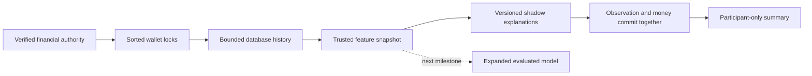
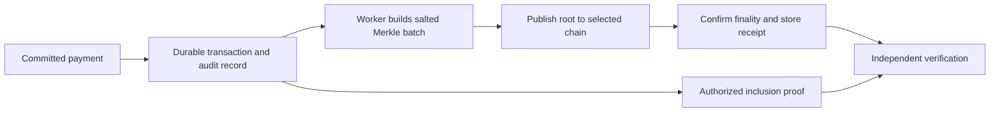

# Rail V2 Foundation

Development continues directly on `main`, starting 8 October 2026. Protected evidence and owner-controlled agent execution are implemented, followed by trusted behavioural observations. This document describes existing modules and their limits. The complete platform roadmap remains in the ignored private scope file. [SECURITY_REVIEW.md](./SECURITY_REVIEW.md) tracks the remaining defects.

## Payment behavior

The existing flow remains: authenticate, reserve funds and persist authorization, optionally issue device-bound offline headroom, execute or sync, consume reservation and write debit/credit ledger rows. Offline features remain part of V2.

The transaction-ID-derived risk placeholder has been removed. There is currently no enforced fraud policy. Authentication, stored authorization, balance and offline-token checks still apply. ML cannot substitute for these checks or independently approve a payment.

## Trainable ML baseline

`src/risk/logisticRisk.ts` implements logistic regression using batch gradient descent on binary cross-entropy, with L2 regularization. No ML framework or external inference API is needed for this small baseline.

Two features are used: log-scaled transaction amount in minor units and an offline-channel indicator. The third weight is the intercept. Currency is declared by the dataset/model; a model is observed only for matching-currency transactions. This avoids silently treating different currencies as comparable amounts. IDs are excluded so choosing a transaction ID does not choose a risk score.

For features `x` and weights `w`, the model computes `z = sum(w[i] * x[i])`, then `p = 1 / (1 + exp(-z))`. Training adjusts weights from labeled examples rather than assigning arbitrary coefficients. Feature contributions explain the log-odds calculation; they do not establish causation.

### Dataset contract

The input JSON requires `modelVersion`, `datasetId`, `currency`, `synthetic`, and separate `training` and `validation` arrays. Each array item contains `amountMinor`, `channel`, and `label` (0 for legitimate, 1 for confirmed fraud). Training needs at least ten rows and both classes; validation needs both classes. These minimums verify the algorithm can run, not that the dataset is sufficient for fraud modeling.

Example shape, with a deliberately synthetic tiny dataset:

```json
{
  "modelVersion": "experiment-001",
  "datasetId": "synthetic-demo",
  "currency": "INR",
  "synthetic": true,
  "training": [
    {"amountMinor": 100, "channel": "online", "label": 0},
    {"amountMinor": 200, "channel": "online", "label": 0},
    {"amountMinor": 300, "channel": "online", "label": 0},
    {"amountMinor": 400, "channel": "online", "label": 0},
    {"amountMinor": 500, "channel": "online", "label": 0},
    {"amountMinor": 1000000, "channel": "nfc", "label": 1},
    {"amountMinor": 1100000, "channel": "ble", "label": 1},
    {"amountMinor": 1200000, "channel": "qr", "label": 1},
    {"amountMinor": 1300000, "channel": "nfc", "label": 1},
    {"amountMinor": 1400000, "channel": "qr", "label": 1}
  ],
  "validation": [
    {"amountMinor": 150, "channel": "online", "label": 0},
    {"amountMinor": 1250000, "channel": "ble", "label": 1}
  ]
}
```

Train using an existing dataset path and a new output path:

```bash
npm run risk:train -- /private/path/dataset.json /private/path/model.json
```

The command writes a model artifact with provenance and weights, refuses to overwrite an existing output file, and prints validation metrics. Real datasets must be protected outside the repository. Do not label operational events as confirmed fraud without a reliable outcome source.

### Evaluation and deployment

Log loss measures confidence in the correct label. Brier score measures squared probability error. Precision and recall are reported at threshold 0.5; this is an experiment threshold rather than a payment policy. Temporal split, customer leakage prevention, class imbalance, calibration, threshold costs and drift monitoring still require dedicated validation. The command accepts supplied splits; it cannot establish their independence or verify the truth of the labels.

`RAIL_RISK_MODEL_PATH` points to a validated model JSON loaded once at server-context creation. An invalid configured model stops initialization. Without this variable, there is no ML inference. No default trained model is shipped because this repository contains no validated real fraud dataset.

For a matching currency, the pipeline appends `risk.shadow_assessed` with mode, probability, model version, synthetic-data status and contributions. The event is visible only to the sender under the existing event filter. It does not alter execution decisions. Database event insertion now shares the financial transaction and the existing worker delivers at least once; consumers must deduplicate delivery IDs. External acknowledgement and production delivery acceptance remain separate from event persistence.

The tests use synthetic examples to verify learning, evaluation, validation and independence from transaction IDs. Their results say nothing about fraud detection accuracy on real transactions.

## Trusted Behavioural Observations

`src/risk/behaviourRisk.ts` collects point-in-time feature snapshots through the supplied financial client after authorization/offline-token checks and sorted wallet locks. History uses posted sender debits joined to persisted executions and used authorizations, restricted to wallet/currency and a 30-day database-clock window. The current transaction is excluded. The query returns at most 1,001 rows; only 1,000 are used and the extra row marks truncation. An indexed sender/currency/time path supports the query, but production latency/load testing remains required.

Features include sampled five-minute payment count, sample-local recipient familiarity, historical mean amount, current-to-mean ratio, statistical amount deviation and optional mandate exposure. Welford's running mean/variance avoids false deviations from constant amounts. Fewer than five samples or zero variance yields no z-score. Features are observations, not fraud probabilities. The fixed thresholds are demonstration policy choices: five recent payments, three-times mean amount, a z-score of three or exposure of 80 percent produce explanation codes without blocking money.

History describes rows visible at the collection statement, including earlier work in a caller-owned transaction. `committed_at` is a stored database transaction timestamp, not proof of the exact instant an outer commit completed. Concurrent normal transfers from the same wallet serialize under wallet locks, so subsequently collected snapshots include their visible predecessors. Offline histories measure reconnect/server processing, not claimed disconnected-device event times. Client timestamps, confidence, history and device-change claims do not enter the trusted feature calculation. Device changes explicitly remain `not_assessed` until enrollment/revocation history is implemented.

`rail_risk_observations` binds one immutable observation to the execution fingerprint. It retains schema/policy versions, database observation time, feature snapshot, explanation and model status; matching models also retain their artifact hash, synthetic flag and prediction/contributions. The pipeline validates/copies its model at construction so caller mutation cannot change the captured version or weights. These features do not yet feed an expanded trained model; the existing model still uses amount/channel. No model configured or a currency mismatch stores an explicit status and no fabricated probability.

New standard-pipeline execution rows set `risk_required`; deferred commit checks reject missing observations. Observation failure rolls back the financial attempt, and retry is allowed. Successful replay does not overwrite observations or re-run a new model. Legacy records are not silently backfilled. These safeguards do not prevent a privileged database owner from disabling triggers. Feature snapshots are relational/private data; AES/HMAC transaction evidence currently protects the canonical payment, not these feature records. Retention, label provenance, encryption of risk records and access auditing require further work before production.

`GET /v1/payments/:txId/risk` returns only a participant-authorized summary: `observed` or `legacy_unobserved`, time, shadow policy level/reasons and model availability/version/synthetic status. Raw historical feature values, probabilities and model hashes are not exposed. Missing and unauthorized payments share 404, responses are non-cacheable and reads have a 30/minute wallet/source quota. `review` does not create a pending money state; `normal` does not certify safety.



Next: trusted outcome labels, temporal independent evaluation, expanded logistic features, drift/calibration checks and explicit unavailable-model behavior. Automated fraud enforcement is not enabled by collecting these observations.

## Audit commitment foundation

`src/crypto/auditCommitment.ts` implements salted SHA-256 transaction commitments, Merkle batch roots and inclusion proof verification. Version prefixes separate leaf, internal-node and root hashing. Leaf encoding uses a JSON array, avoiding ambiguous delimiter concatenation. The root binds the batch count; odd levels duplicate the final node deterministically.

Generate a distinct salt for each payment using `randomBytes(32).toString("hex")`. Keep salts, transaction details and proofs in protected storage. Publishing the root alone avoids putting wallet identifiers, amounts or credentials on-chain. Salt format validation cannot prove callers generated random, non-reused salts.



This diagram is the integration design. Only commitment/proof computation is implemented. There is no chain client, contract, scheduled batcher, durable salt/proof table, wallet funding, external checkpoint or finality tracker yet. Roots are not currently inserted automatically during payment execution.

Anchoring must run after financial commit. A chain outage must delay an audit anchor rather than reverse a completed payment. Reorganizations need confirmation policy and re-anchoring. An independent verifier must have a trusted root/checkpoint; a database administrator can rewrite a locally stored tree and its root together.

A valid proof shows inclusion of the supplied commitment under a trusted root. It does not establish settlement, authorization validity, correctness of the input data or completeness of the batch. Merkle roots are not encryption. Clients should receive proofs only for records they are permitted to inspect.

## Why these choices

Small TypeScript modules keep the algorithm understandable and avoid a network dependency on the payment path. A measured need can justify a separate model service or different runtime later. PostgreSQL remains the current financial source of truth; a public audit anchor supplements it.

Model probability calibration should be validated before probability-based decisions: [scikit-learn calibration documentation](https://scikit-learn.org/stable/modules/calibration.html). Public blockchain records and associated metadata need careful privacy design: [Ethereum privacy overview](https://ethereum.org/privacy/ethereum).
